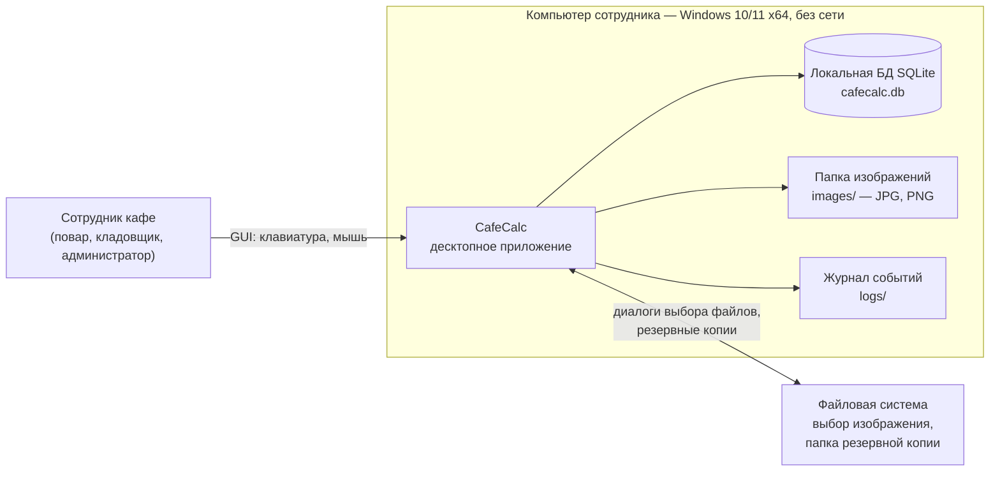
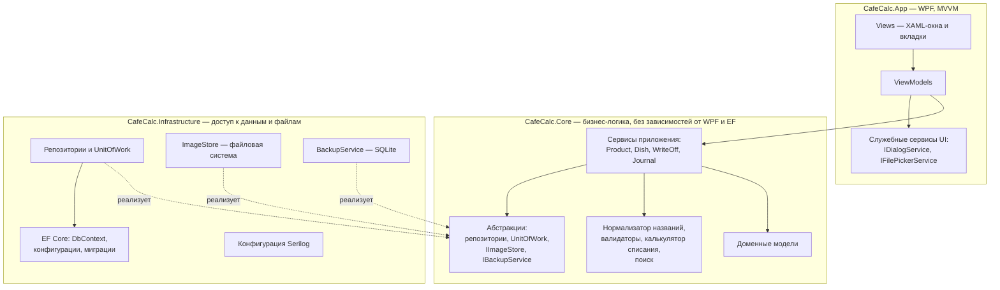
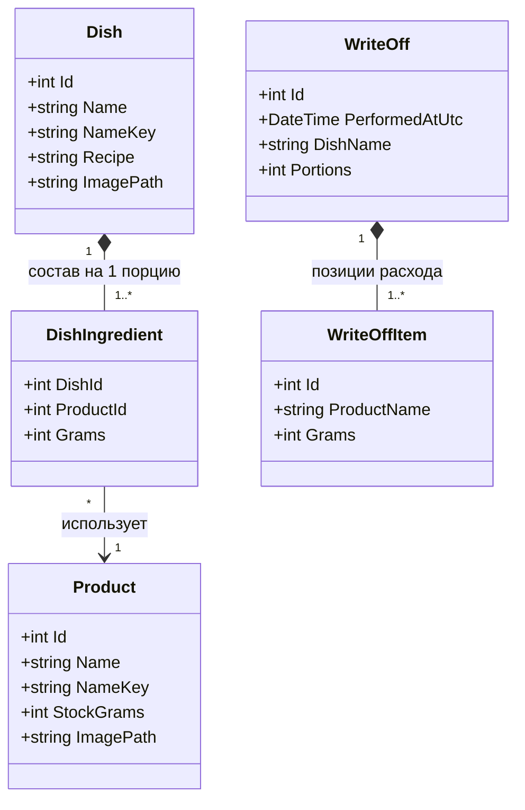
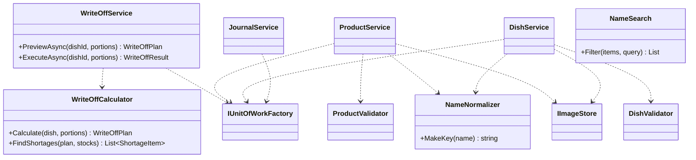
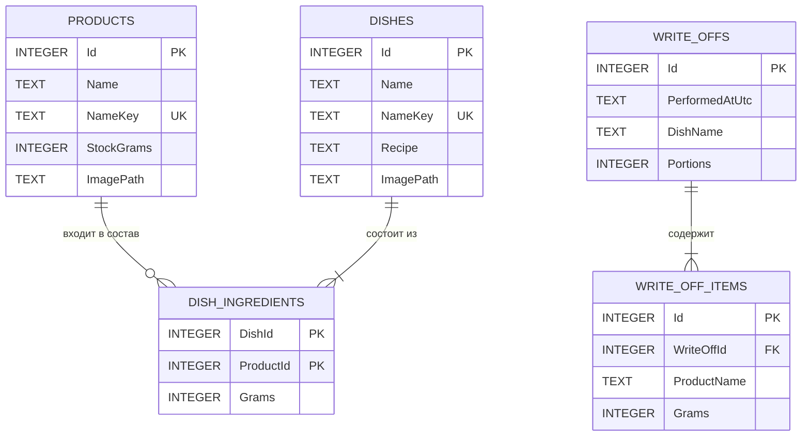
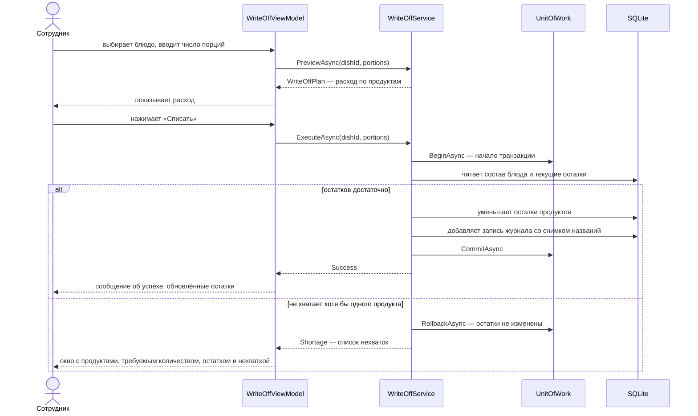
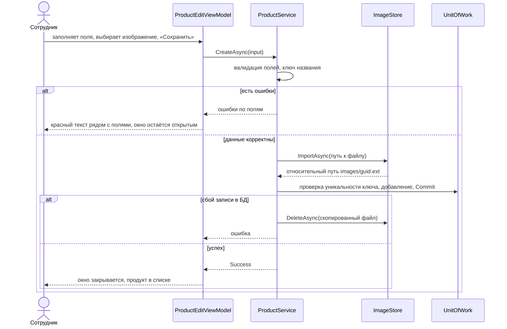
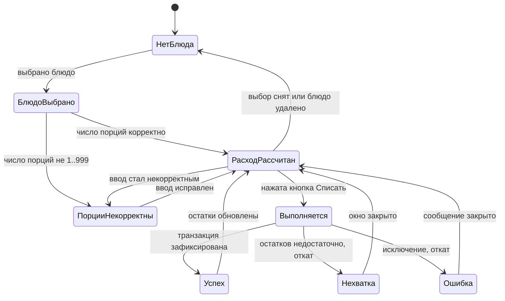
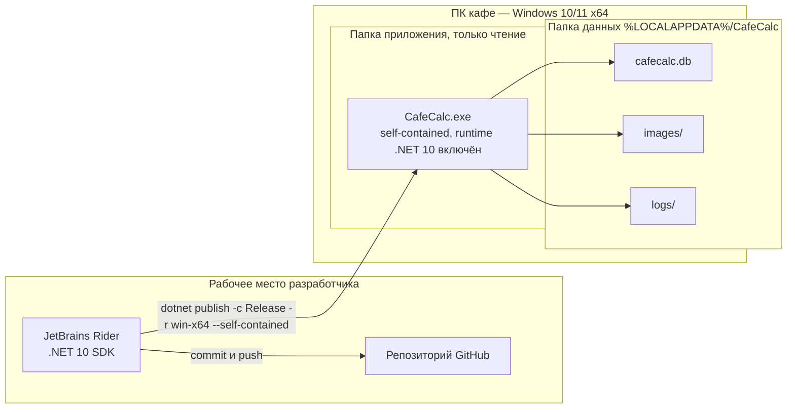
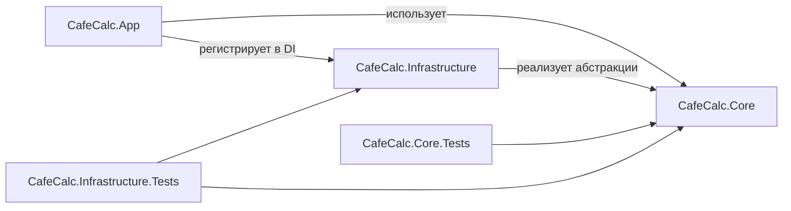

# Описание дизайна программного обеспечения

Для CafeCalc — автоматизированной системы учёта продуктов и готовых блюд кафе

Версия 0.1

Подготовил Пастухов Максим Викторович, гр. 450501

БГУИР, кафедра электронных вычислительных машин

11.11.2026

## Оглавление

<!-- TOC -->
* [1. Введение](#1-introduction)
  * [1.1 Назначение документа](#11-document-purpose)
  * [1.2 Область применения](#12-subject-scope)
  * [1.3 Определения, акронимы и сокращения](#13-definitions-acronyms-and-abbreviations)
  * [1.4 Ссылки](#14-references)
  * [1.5 Обзор документа](#15-document-overview)
* [2. Обзор дизайна](#2-design-overview)
  * [2.1 Задачи стейкхолдеров](#21-stakeholder-concerns)
  * [2.2 Выбранные точки зрения](#22-selected-viewpoints)
    * [2.2.1 Контекст](#221-context)
    * [2.2.2 Композиция](#222-composition)
    * [2.2.3 Логическое представление](#223-logical)
    * [2.2.4 Физическое представление](#224-physical)
    * [2.2.5 Структура](#225-structure)
    * [2.2.6 Зависимости](#226-dependency)
    * [2.2.7 Информация](#227-information)
    * [2.2.8 Интерфейс](#228-interface)
    * [2.2.9 Взаимодействие](#229-interaction)
    * [2.2.10 Алгоритм](#2210-algorithm)
    * [2.2.11 Динамика состояний](#2211-state-dynamics)
    * [2.2.12 Параллелизм](#2212-concurrency)
    * [2.2.13 Паттерны](#2213-patterns)
    * [2.2.14 Развёртывание](#2214-deployment)
    * [2.2.15 Ресурсы](#2215-resources)
* [3. Проектные представления](#3-design-views)
* [4. Решения](#4-decisions)
* [5. Приложения](#5-appendixes)
<!-- TOC -->

## История изменений

| Name | Date | Reason For Changes | Version |
|------|------|--------------------|---------|
| Пастухов Максим Викторович | 11.11.2026 | Первая версия SDD на основе согласованного SRS; добавлены ADR-0001…0008 | 0.1 |

---

## 1. Введение {#1-introduction}

Документ описывает проектное решение настольного приложения CafeCalc: как устроена система, из каких частей она состоит, как хранит данные и как реализует требования из SRS. Он отвечает на вопрос «как», в то время как SRS отвечает на вопрос «что».

### 1.1 Назначение документа {#11-document-purpose}

SDD служит руководством к действию для команды разработки: разработчик по нему реализует систему, тестировщик строит интеграционные и модульные тесты, сопровождающий понимает, где и почему принято то или иное решение. Документ опирается на SRS (требования `REQ-*`) и на протоколы архитектурных решений ADR (раздел 4 и каталог `adr/`). Он ведётся в репозитории вместе с кодом и обновляется при каждом значимом изменении дизайна.

### 1.2 Область применения {#12-subject-scope}

**Система:** CafeCalc, версия 1.0 (первый релиз).

CafeCalc — автономное десктопное приложение для Windows 10/11 x64. Оно хранит продукты и остатки (в граммах), позволяет искать продукт по названию, вести меню блюд с изображениями, составом и текстовым рецептом и одной кнопкой списывать продукты по выбранному блюду с контролем остатков и записью в журнал. Приложение работает на одном компьютере без сети; данные хранятся в локальной БД SQLite, изображения — файлами. Дизайн напрямую поддерживает бизнес-цели SRS: BG-1 (быстрый поиск — размещённый в памяти индекс и виртуализированный список), BG-2 (автоматический расчёт расхода — алгоритм 007), BG-3 (рецепты и фото в одном месте — представления 003, 004), BG-4 (защита от ухода в минус — решение ADR-0006).

**Входит в SDD:** вся система целиком (SDD охватывает единственное приложение; более крупной системы нет).

**Не входит (как и в SRS 1.0):** учёт продаж, цен и себестоимости; закупки; многопользовательский и сетевой режимы; единицы измерения, кроме граммов; мобильная и веб-версии; интеграции с внешними сервисами.

### 1.3 Определения, акронимы и сокращения {#13-definitions-acronyms-and-abbreviations}

| Term | Definition |
|------|------------|
| ADR | Architectural Decision Record — протокол архитектурного решения |
| API | Application Programming Interface — набор определений и протоколов для создания и интеграции прикладного ПО |
| CRUD | Create, Read, Update, Delete — базовые операции над данными |
| DI | Dependency Injection — внедрение зависимостей |
| EF Core | Entity Framework Core — ORM для .NET |
| LTS | Long Term Support — релиз .NET с трёхлетней поддержкой |
| MADR | Markdown Architecture Decision Records — формат записи ADR |
| MVVM | Model–View–ViewModel — паттерн разделения интерфейса и логики представления |
| NuGet | Менеджер пакетов .NET |
| SDD | Software Design Description — документ, описывающий дизайн ПО |
| SRS | Software Requirements Specification — спецификация требований к ПО |
| SQLite | Встраиваемая реляционная СУБД, хранящая БД в одном файле |
| UoW | Unit of Work — единица работы (группа операций с БД в одной транзакции) |
| WPF | Windows Presentation Foundation — UI-фреймворк для настольных приложений Windows |
| Инкремент | Этап поставки: 1 — Склад, 2 — Меню и рецепты, 3 — Списание и журнал (SRS 2.6) |
| Ключ названия (NameKey) | Нормализованная форма названия (без учёта регистра и лишних пробелов), используемая для проверки уникальности и поиска |
| Снимок (snapshot) | Копия данных на момент операции; в журнале списаний хранятся названия блюда и продуктов, а не ссылки на них |

Термины предметной области (блюдо, продукт, остаток, списание, порция и т. д.) определены в SRS 1.3 и используются без изменений.

### 1.4 Ссылки {#14-references}

| № | Документ | Владелец | Версия/дата | Расположение | Тип |
|---|----------|----------|-------------|--------------|-----|
| 1 | Спецификация требований CafeCalc (SRS) | Автор SRS | актуальная версия в репозитории | `srs/srs.md` | Нормативный |
| 2 | Лабораторная работа №4 «Разработка и документирование системных требований» | кафедра, БГУИР | — | `Лабораторная_работа_4.pdf` | Справочный |
| 3 | Шаблон SDD | репозиторий курса | — | `Templates/sdd/sdd-template.md` | Нормативный |
| 4 | Шаблон ADR | репозиторий курса | — | `Templates/adr/adr-template.md` | Нормативный |
| 5 | Протоколы архитектурных решений ADR-0001…0008 | Автор SDD | 11.11.2026 | `adr/` | Нормативный |
| 6 | Мокапы интерфейса (SysML v2, PNG) | Автор SRS | 0.1 | `srs/sysml/`, `srs/img/` | Справочный |
| 7 | ISO/IEC/IEEE 42010:2022, Architecture description | ISO/IEC/IEEE | 2022 | — | Справочный |
| 8 | MADR (Markdown Architecture Decision Records) | сообщество | — | https://adr.github.io/madr/ | Справочный |
| 9 | .NET and .NET Core Support Policy | Microsoft | актуальна на 11.11.2026 | https://dotnet.microsoft.com/platform/support/policy/dotnet-core | Справочный |

### 1.5 Обзор документа {#15-document-overview}

Раздел 2 определяет стейкхолдеров и выбранные точки зрения. Раздел 3 содержит 14 проектных представлений `001…014` с диаграммами (Mermaid, отображаются на GitHub) и ссылками на требования SRS. Раздел 4 перечисляет решения `001…008` с краткой записью и ссылкой на полный ADR. Раздел 5 содержит матрицу приоритетов и трассируемости (5.1), словарь данных (5.2) и замечания к SRS, выявленные при проектировании (5.3). Приоритеты функций указаны по шкале от 10 (наивысший) до 50 (минимальный). Изменения фиксируются в «Истории изменений» и в истории коммитов.

---

## 2. Обзор дизайна {#2-design-overview}

Система проектируется как трёхслойное приложение (интерфейс WPF по MVVM — бизнес-логика — доступ к данным) с локальной БД SQLite. Ключевые идеи: бизнес-логика не зависит ни от UI, ни от СУБД и целиком покрывается модульными тестами; все изменяющие операции над несколькими записями выполняются в одной транзакции; регистронезависимость для кириллицы обеспечивается приложением, а не СУБД; поставка самодостаточна и не требует установки runtime или СУБД.

### 2.1 Задачи стейкхолдеров {#21-stakeholder-concerns}

| Стейкхолдер | Основные задачи | Адресуется |
|-------------|-----------------|------------|
| Заказчик (владелец / управляющий кафе) | Сроки и стоимость; достижение BG-1…BG-4; сохранность данных учёта | 001, 009, 010; ADR-0002, 0006; прил. 5.1 |
| Сотрудник кафе (повар, кладовщик, администратор) | Быстрый отклик; понятный русский интерфейс; невозможность «испортить» учёт; простое списание | 005, 006, 008, 011; ADR-0001, 0005, 0006 |
| Разработчик | Понятные границы слоёв; тестируемость; воспроизводимая сборка | 002, 003, 007, 013, 014; ADR-0001, 0003, 0004 |
| Тестировщик | Проверяемость требований; детерминированная бизнес-логика; тестирование на изолированной БД | 004, 007, 008; ADR-0003, 0004; раздел 4 SRS |
| Оператор / сопровождающий | Установка без СУБД и runtime; резервные копии; диагностика сбоев | 010, 011, 012; ADR-0002, 0007, 0008 |
| Преподаватель | Соответствие шаблонам; прослеживаемость требований до решений | прил. 5.1 |

### 2.2 Выбранные точки зрения {#22-selected-viewpoints}

Точки зрения выбраны исходя из задач стейкхолдеров (2.1). Каждая применённая точка зрения реализована одним проектным представлением в разделе 3.

| Точка зрения | Применение | Представление | Язык |
|--------------|------------|---------------|------|
| 2.2.1 Контекст | Да | 001-context | Контекстная диаграмма, таблица вариантов использования |
| 2.2.2 Композиция | Да | 002-composition | Диаграмма компонентов (Mermaid flowchart) |
| 2.2.3 Логическое представление | Да | 003-logical | Диаграмма классов UML (Mermaid) |
| 2.2.4 Физическое представление | Нет — нестандартного оборудования нет; опорный ПК задан в REQ-PERF-001 и описан в 010 и 011 | — | — |
| 2.2.5 Структура | Да | 013-structure | Дерево решения, таблица проектов |
| 2.2.6 Зависимости | Да | 014-dependency | Граф зависимостей, таблица NuGet-пакетов |
| 2.2.7 Информация | Да | 004-information | ER-диаграмма (Mermaid), DDL |
| 2.2.8 Интерфейс | Да | 005-interface | Сигнатуры C#, таблица окон |
| 2.2.9 Взаимодействие | Да | 006-interaction | Диаграммы последовательности (Mermaid) |
| 2.2.10 Алгоритм | Да | 007-algorithm | Псевдокод |
| 2.2.11 Динамика состояний | Да | 008-state-dynamics | Диаграмма состояний (Mermaid), таблица |
| 2.2.12 Параллелизм | Да (минимально) | 012-concurrency | Описание, таблица |
| 2.2.13 Паттерны | Да | 009-patterns | Таблица паттернов |
| 2.2.14 Развёртывание | Да | 010-deployment | Диаграмма развёртывания (Mermaid), структура папок |
| 2.2.15 Ресурсы | Да | 011-resources | Таблица бюджета ресурсов |

Подробные описания представлений находятся в разделе 3 (идентификаторы `001…014`).

#### 2.2.1 Контекст {#221-context}

Определяет систему как «чёрный ящик»: границы, акторы и сервисы. См. **001-context**.

#### 2.2.2 Композиция {#222-composition}

Определяет крупные части системы и распределение ответственности. См. **002-composition**.

#### 2.2.3 Логическое представление {#223-logical}

Определяет статические типы и их связи. См. **003-logical**.

#### 2.2.4 Физическое представление {#224-physical}

Не применяется отдельно. Система работает на одном стандартном ПК (Windows 10/11 x64; опорная конфигурация для замеров — 4 ГБ ОЗУ, двухъядерный процессор, HDD, REQ-PERF-001). Периферия (сканеры, весы, принтеры) не используется (SRS 3.1.2).

#### 2.2.5 Структура {#225-structure}

Определяет внутреннюю организацию решения (проекты, папки, ключевые классы). См. **013-structure**.

#### 2.2.6 Зависимости {#226-dependency}

Определяет зависимости между проектами и внешними библиотеками. См. **014-dependency**.

#### 2.2.7 Информация {#227-information}

Определяет структуру постоянных данных и ограничения целостности. См. **004-information**.

#### 2.2.8 Интерфейс {#228-interface}

Определяет контракты между слоями и окна приложения. См. **005-interface**.

#### 2.2.9 Взаимодействие {#229-interaction}

Определяет порядок сообщений в основных сценариях. См. **006-interaction**.

#### 2.2.10 Алгоритм {#2210-algorithm}

Определяет логику ключевых операций: нормализация названий, поиск, расчёт и выполнение списания, проверка изображения, резервное копирование. См. **007-algorithm**.

#### 2.2.11 Динамика состояний {#2211-state-dynamics}

Определяет состояния панели списания и доступность элементов управления. См. **008-state-dynamics**.

#### 2.2.12 Параллелизм {#2212-concurrency}

Определяет потоковую модель и защиту от двух экземпляров приложения. См. **012-concurrency**.

#### 2.2.13 Паттерны {#2213-patterns}

Фиксирует применённые паттерны проектирования. См. **009-patterns**.

#### 2.2.14 Развёртывание {#2214-deployment}

Определяет упаковку, расположение файлов и установку. См. **010-deployment**.

#### 2.2.15 Ресурсы {#2215-resources}

Определяет бюджет памяти, дисковых и прочих ресурсов. См. **011-resources**.

---
## 3. Проектные представления {#3-design-views}

Для каждого представления указаны идентификатор, точка зрения, содержимое, реализуемые требования SRS и связанные решения (раздел 4).

### 001-context — Контекст системы

- **ID**: 001-context
- **Title**: Контекст системы и варианты использования
- **Viewpoint**: Контекст (2.2.1)
- **Representation**:



Единственный актор — «Сотрудник кафе» (SRS 2.4). Внешних систем и сетевых соединений нет (REQ-SEC-002).

| № | Вариант использования | Функции SRS | Инкремент |
|---|------------------------|-------------|-----------|
| UC-1 | Просмотреть склад, найти и выбрать продукт | REQ-FUNC-001…003 | 1 |
| UC-2 | Добавить продукт (отдельное окно, проверка данных, изображение) | REQ-FUNC-004…006 | 1 |
| UC-3 | Пополнить, изменить, удалить продукт | REQ-FUNC-007, 008 | 1 |
| UC-4 | Просмотреть меню, найти блюдо, открыть карточку и рецепт | REQ-FUNC-010, 012, 013 | 2 |
| UC-5 | Создать, изменить, удалить блюдо | REQ-FUNC-011, 013 | 2 |
| UC-6 | Списать продукты по блюду | REQ-FUNC-014, 015 | 3 |
| UC-7 | Просмотреть журнал списаний | REQ-FUNC-016 | 3 |
| UC-8 | Создать резервную копию и восстановить данные | REQ-REL-002 | все |

- **More Information**: SRS 2.1, 2.2, 2.4; решения 002 (платформа), 007 (данные и файлы).

---

### 002-composition — Композиция

- **ID**: 002-composition
- **Title**: Функциональная декомпозиция на слои и компоненты
- **Viewpoint**: Композиция (2.2.2)
- **Representation**:



| Компонент | Ответственность | Реализуемые требования |
|-----------|-----------------|------------------------|
| Views | Разметка окон, привязки к ViewModel, без логики | REQ-INT-001…003 |
| ViewModels | Состояние экрана, команды, преобразование ввода, отображение ошибок | REQ-FUNC-001…016 (UI-часть) |
| Сервисы приложения | Сценарии: создание, изменение, удаление, списание; транзакционные границы | REQ-FUNC-004…016, REQ-REL-001 |
| Нормализатор, валидаторы, калькулятор, поиск | Чистая бизнес-логика без ввода-вывода | REQ-FUNC-002, 005, 011, 013, 014, 015 |
| Репозитории и UnitOfWork | Доступ к БД, транзакции | REQ-INT-004, REQ-SEC-001 |
| ImageStore | Копирование и проверка изображений | REQ-INT-005, REQ-FUNC-006 |
| BackupService | Резервная копия и восстановление | REQ-REL-002 |

Покупных готовых компонентов (повторное использование) нет, кроме библиотек из 014; всё остальное разрабатывается.

- **More Information**: решения 001, 003, 004; представления 005, 013, 014.

---

### 003-logical — Логическое представление

- **ID**: 003-logical
- **Title**: Доменные типы и сервисы
- **Viewpoint**: Логическое представление (2.2.3)
- **Representation**:

Доменные модели:



Сервисы и вспомогательные типы:



Основные типы результатов: `OperationResult` (успех либо словарь «поле → сообщение об ошибке»), `WriteOffPlan` (список «продукт — требуемые граммы»), `WriteOffResult` (`Success` либо `Shortage` со списком `ShortageItem`: продукт, требуется, остаток, не хватает), `DeleteProductResult` (удалено либо заблокировано с перечнем блюд). Все количества — граммы (`int` для хранения, `long` в расчётах).

- **More Information**: REQ-FUNC-005, 008, 009, 011, 014…016; решения 003, 005, 006.

---

### 004-information — Информация

- **ID**: 004-information
- **Title**: Модель постоянных данных SQLite
- **Viewpoint**: Информация (2.2.7)
- **Representation**:



Ключевое определение схемы (SQLite):

```sql
CREATE TABLE Products (
    Id         INTEGER PRIMARY KEY AUTOINCREMENT,
    Name       TEXT    NOT NULL CHECK (length(Name) BETWEEN 1 AND 100),
    NameKey    TEXT    NOT NULL UNIQUE,
    StockGrams INTEGER NOT NULL CHECK (StockGrams BETWEEN 0 AND 10000000),
    ImagePath  TEXT    NULL
);

CREATE TABLE Dishes (
    Id        INTEGER PRIMARY KEY AUTOINCREMENT,
    Name      TEXT NOT NULL CHECK (length(Name) BETWEEN 1 AND 100),
    NameKey   TEXT NOT NULL UNIQUE,
    Recipe    TEXT NOT NULL CHECK (length(Recipe) BETWEEN 1 AND 5000),
    ImagePath TEXT NULL
);

CREATE TABLE DishIngredients (
    DishId    INTEGER NOT NULL REFERENCES Dishes(Id)   ON DELETE CASCADE,
    ProductId INTEGER NOT NULL REFERENCES Products(Id) ON DELETE RESTRICT,
    Grams     INTEGER NOT NULL CHECK (Grams > 0),
    PRIMARY KEY (DishId, ProductId)
);

CREATE TABLE WriteOffs (
    Id             INTEGER PRIMARY KEY AUTOINCREMENT,
    PerformedAtUtc TEXT    NOT NULL,                    -- ISO 8601, UTC
    DishName       TEXT    NOT NULL,                    -- снимок названия
    Portions       INTEGER NOT NULL CHECK (Portions BETWEEN 1 AND 999)
);

CREATE TABLE WriteOffItems (
    Id         INTEGER PRIMARY KEY AUTOINCREMENT,
    WriteOffId INTEGER NOT NULL REFERENCES WriteOffs(Id) ON DELETE CASCADE,
    ProductName TEXT   NOT NULL,                        -- снимок названия
    Grams      INTEGER NOT NULL CHECK (Grams > 0)
);
```

Принципы:

- Целостность обеспечивается на уровне БД: уникальность `NameKey`, внешние ключи, `CHECK (StockGrams >= 0)`, составной ключ `(DishId, ProductId)` запрещает повтор продукта в составе (REQ-SEC-001, REQ-FUNC-011). Внешние ключи включаются на каждом соединении.
- Таблицы журнала **не имеют внешних ключей** на блюда и продукты: хранятся названия на момент списания, поэтому записи переживают удаление блюда или продукта (REQ-FUNC-016).
- `ON DELETE RESTRICT` на `ProductId` — вторая линия защиты для REQ-FUNC-008; основная проверка выполняется в сервисе, который формирует список блюд для сообщения пользователю.
- Правило «блюдо должно иметь хотя бы один продукт в составе» не выражается ограничением SQLite и проверяется сервисом `DishService` внутри транзакции сохранения (см. 5.3, замечание DR-5).
- Время хранится в UTC, отображается в локальном времени.
- Схема создаётся и изменяется миграциями EF Core (решение 004). Подробный словарь данных — приложение 5.2.

- **More Information**: REQ-INT-004, REQ-SEC-001, REQ-FUNC-008, 009, 011, 013, 016; решения 004, 005, 006.

---

### 005-interface — Интерфейсы

- **ID**: 005-interface
- **Title**: Контракты сервисов и окна приложения
- **Viewpoint**: Интерфейс (2.2.8)
- **Representation**:

Контракты сервисов (`CafeCalc.Core`, эскиз; точные сигнатуры уточняются при реализации):

```csharp
public interface IProductService
{
    Task<IReadOnlyList<Product>> GetAllAsync(CancellationToken ct = default);
    Task<OperationResult<Product>> CreateAsync(ProductInput input, CancellationToken ct = default);
    Task<OperationResult<Product>> UpdateAsync(int id, ProductInput input, CancellationToken ct = default);
    Task<OperationResult> TopUpAsync(int id, string gramsText, CancellationToken ct = default);
    Task<DeleteProductResult> DeleteAsync(int id, CancellationToken ct = default);
}

public interface IDishService
{
    Task<IReadOnlyList<Dish>> GetAllAsync(CancellationToken ct = default);
    Task<Dish?> GetAsync(int id, CancellationToken ct = default);
    Task<OperationResult<Dish>> SaveAsync(DishInput input, CancellationToken ct = default); // создание и изменение
    Task<OperationResult> DeleteAsync(int id, CancellationToken ct = default);
}

public interface IWriteOffService
{
    Task<WriteOffPlan> PreviewAsync(int dishId, int portions, CancellationToken ct = default);
    Task<WriteOffResult> ExecuteAsync(int dishId, int portions, CancellationToken ct = default);
}

public interface IJournalService
{
    Task<IReadOnlyList<WriteOff>> GetAsync(string? dishNameQuery, CancellationToken ct = default); // новые сверху
}

public interface IImageStore
{
    Task<OperationResult<string>> ImportAsync(string sourcePath, CancellationToken ct = default); // относительный путь
    string? ResolveFullPath(string? relativePath);
    Task DeleteAsync(string? relativePath);
}

public interface IBackupService
{
    Task CreateAsync(string targetFolder, CancellationToken ct = default);
    Task<OperationResult> RestoreAsync(string backupFolder, CancellationToken ct = default);
}

public interface IUnitOfWorkFactory
{
    IUnitOfWork Create();   // IUnitOfWork: Products, Dishes, WriteOffs, BeginAsync, CommitAsync, RollbackAsync
}
```

Окна приложения:

| Окно / вкладка | ViewModel | Тип | Требования | Макет SRS |
|----------------|-----------|-----|------------|-----------|
| Главное окно (вкладки «Склад», «Меню блюд», «Журнал списаний») | `MainViewModel` | основное | REQ-INT-001 | 01, 04 |
| Вкладка «Склад» (поиск, список, сведения) | `StockViewModel` | вкладка | REQ-FUNC-001…003, 006…008 | 01 |
| «Новый продукт» / «Изменить продукт» | `ProductEditViewModel` | модальное | REQ-FUNC-004…006 | 02, 03 |
| «Пополнить» (ввод граммов) | `TopUpViewModel` | модальное | REQ-FUNC-007 | — |
| Вкладка «Меню блюд» (поиск, карточка, списание) | `MenuViewModel`, `WriteOffViewModel` | вкладка | REQ-FUNC-010, 012…014 | 04 |
| «Новое блюдо» / «Изменить блюдо» | `DishEditViewModel` | модальное | REQ-FUNC-011, 013 | 06 |
| Сообщение о нехватке продуктов | `ShortageViewModel` | модальное | REQ-FUNC-015 | 05 |
| Вкладка «Журнал списаний» | `JournalViewModel` | вкладка | REQ-FUNC-016 | — |
| Резервное копирование и восстановление | `BackupViewModel` | модальное | REQ-REL-002 | — |

Правила интерфейса (REQ-INT-002, 003): культура `ru-RU`, единицы только «г»; минимальный размер окна 1280×720; ошибки ввода — рядом с полем красным текстом (`INotifyDataErrorInfo` через `ObservableValidator`); `Ctrl+F` — фокус на поиск, `Esc` — закрыть модальное окно, `Enter` — подтвердить форму; фокус на поле поиска при открытии вкладки «Склад». Модальные окна открываются через `IDialogService` (`ShowDialog`), что блокирует главное окно (REQ-INT-001) и позволяет подменять диалоги в тестах ViewModel.

Внешние интерфейсы: файл БД SQLite (REQ-INT-004), папка изображений (REQ-INT-005); сетевых API нет.

- **More Information**: решения 001, 003, 004, 007.

---

### 006-interaction — Взаимодействие

- **ID**: 006-interaction
- **Title**: Сценарии «Списание продуктов» и «Добавление продукта»
- **Viewpoint**: Взаимодействие (2.2.9)
- **Representation**:

Списание (успешный путь и путь нехватки, REQ-FUNC-014, 015, 016, REQ-REL-001):



Добавление продукта с изображением (REQ-FUNC-004…006, REQ-INT-005):



При «Отмена» никакие данные и файлы не сохраняются.

- **More Information**: решения 006, 007; алгоритмы 007; состояния 008.

---

### 007-algorithm — Алгоритмы

- **ID**: 007-algorithm
- **Title**: Ключевые алгоритмы бизнес-логики
- **Viewpoint**: Алгоритм (2.2.10)
- **Representation**:

**A1. Ключ названия (`NameNormalizer.MakeKey`, REQ-FUNC-005).**

```text
MakeKey(name):
    s = name.Trim()
    s = заменить любые последовательности пробельных символов на один пробел
    return s.ToUpperInvariant()
```

Название «Мука пшеничная» и « мука  ПШЕНИЧНАЯ » дают один ключ. Сложность O(n) по длине строки. Ключ хранится в колонке `NameKey` с уникальным индексом (решение 005).

**A2. Поиск по названию (`NameSearch.Filter`, REQ-FUNC-002, 010, 016).**

```text
Filter(items, query):
    q = query.Trim()
    if q пусто: return items (в порядке сортировки по названию)
    return items, где item.Name.Contains(q, StringComparison.OrdinalIgnoreCase)
```

Выполняется в памяти по списку, загруженному при открытии вкладки; обновление по мере ввода. Сложность O(N·L), N ≤ 5000 — порядка миллисекунд при цели ≤ 300 мс (REQ-PERF-001). Счётчик «Найдено: N из M» берётся из результата.

**A3. Разбор граммов (`GramsParser`, REQ-FUNC-005, 007, 009, 011).**

```text
TryParseGrams(text, min, max):
    s = text.Trim()
    разрешены только цифры 0–9 (никаких знаков, запятых, пробелов внутри, единиц)
    value = Int64.Parse(s) с проверкой переполнения
    return min <= value <= max
```

Значения «», «12,5», «-5», «abc», «2 ложки» отклоняются; «0» допустим там, где `min = 0` (остаток), и недопустим для пополнения и состава (`min = 1`).

**A4. Расчёт списания (`WriteOffCalculator.Calculate`, REQ-FUNC-014).**

```text
Calculate(dish, portions):          // portions проверено: 1..999
    plan = []
    for ing in dish.Ingredients:
        need = (long) ing.Grams * portions
        plan.add(ing.ProductId, ing.ProductName, need)
    return plan
```

Пример: «Омлет с сыром», 2 порции → 240, 100, 60, 20, 4 г. Вычисления в `long` исключают переполнение. Сложность O(k), k — число продуктов в составе.

**A5. Выполнение списания (`WriteOffService.ExecuteAsync`, REQ-FUNC-014…016, REQ-REL-001).**

```text
ExecuteAsync(dishId, portions):
    проверить 1 <= portions <= 999, иначе ошибка ввода
    uow.Begin()
    dish = uow.Dishes.GetWithIngredients(dishId)           // свежие данные
    if dish == null: uow.Rollback(); return Error("Блюдо не найдено")
    plan = Calculator.Calculate(dish, portions)
    products = uow.Products.GetByIds(plan.ProductIds)      // свежие остатки
    shortages = [ (name, need, stock, need - stock) для каждой позиции плана, где stock < need ]
    if shortages не пусто: uow.Rollback(); return Shortage(shortages)
    for item in plan: product.StockGrams -= item.Need
    uow.WriteOffs.Add(utcNow, dish.Name, portions, items со снимком названий)
    uow.Commit()                                           // атомарно
    return Success
    // при любом исключении: Rollback, лог ошибки, остатки прежние
```

Проверка остатков повторяется внутри транзакции, поскольку между предварительным расчётом и нажатием «Списать» данные могли измениться. Ограничение `CHECK (StockGrams >= 0)` — страховка: нарушение преобразуется в ошибку без изменения данных.

**A6. Проверка и импорт изображения (`ImageStore.ImportAsync`, REQ-INT-005).**

```text
ImportAsync(sourcePath):
    проверить расширение .jpg/.jpeg/.png (без учёта регистра)
    проверить размер файла <= 5 МБ
    проверить, что файл действительно декодируется как JPEG/PNG (сигнатура и декодер)
    name = Guid + расширение; скопировать в <data>/images/name
    return "images/" + name
```

Любое нарушение — сообщение об ошибке на русском, файл не копируется.

**A7. Резервное копирование и восстановление (REQ-REL-002).**

```text
Create(targetFolder):
    dir = targetFolder/backup-yyyyMMdd-HHmmss
    выполнить VACUUM INTO dir/cafecalc.db      // согласованный снимок открытой БД
    скопировать <data>/images -> dir/images

Restore(backupFolder):
    проверить наличие cafecalc.db и images, открыть БД, PRAGMA integrity_check, версию схемы <= версии приложения
    автоматически создать резервную копию текущих данных
    закрыть соединения, заменить БД и images, перезапустить приложение
```

- **More Information**: SRS 3.2; решения 005, 006, 007.

---
### 008-state-dynamics — Динамика состояний

- **ID**: 008-state-dynamics
- **Title**: Состояния панели списания и доступность элементов
- **Viewpoint**: Динамика состояний (2.2.11)
- **Representation**:



| Состояние | Кнопка «Списать» | Поле порций | Что показано |
|-----------|------------------|-------------|--------------|
| НетБлюда | недоступна | недоступно | подсказка «Выберите блюдо» |
| БлюдоВыбрано / ПорцииНекорректны | недоступна | доступно | сообщение об ошибке у поля |
| РасходРассчитан | доступна | доступно | расход по каждому продукту (г) |
| Выполняется | недоступна | недоступно | индикатор выполнения |
| Успех / Нехватка / Ошибка | недоступна до закрытия сообщения | недоступно | результат операции |

Аналогичное правило для вкладки «Склад» (REQ-FUNC-003): пока продукт не выбран, кнопки «Пополнить», «Изменить», «Удалить» недоступны. Все кнопки на время выполнения операции блокируются, что исключает повторное нажатие.

- **More Information**: REQ-FUNC-003, 014, 015; алгоритм A5; решение 006.

---

### 009-patterns — Паттерны

- **ID**: 009-patterns
- **Title**: Применённые паттерны и архитектурные стили
- **Viewpoint**: Паттерны (2.2.13)
- **Representation**:

| Паттерн / стиль | Где применён | Зачем |
|-----------------|--------------|-------|
| Layered architecture | App → Core ← Infrastructure | Разделение ответственности, тестируемость (REQ-MAINT-001) |
| MVVM | Views ↔ ViewModels (CommunityToolkit.Mvvm) | Нет логики в code-behind, тесты ViewModel |
| Dependency Injection | Контейнер `Microsoft.Extensions.DependencyInjection`, сборка в `App.xaml.cs` | Подмена зависимостей в тестах |
| Repository + Unit of Work | `IUnitOfWork`, репозитории в Core, реализация в Infrastructure | Транзакционные границы сервисов (REQ-REL-001) |
| Service Layer | `ProductService`, `DishService`, `WriteOffService`, `JournalService` | Сценарии использования вне UI |
| Result Object | `OperationResult`, `WriteOffResult`, `DeleteProductResult` | Ожидаемые отказы (ошибки ввода, нехватка) — не исключения |
| Snapshot | Журнал списаний хранит названия | Записи переживают удаление блюд и продуктов (REQ-FUNC-016) |
| Null Object (заглушка) | Изображение по умолчанию | Отсутствие или повреждение файла не ломает UI (REQ-FUNC-006, REQ-REL-003) |
| Defense in depth | Проверка в UI → сервис → ограничения БД | Целостность данных (REQ-SEC-001) |

Правила стиля: бизнес-правила живут только в `CafeCalc.Core`; ViewModel не обращается к БД и файловой системе напрямую; исключения не используются для управления потоком; код оформляется по соглашениям C#.

- **More Information**: решения 001, 003, 006.

---

### 010-deployment — Развёртывание

- **ID**: 010-deployment
- **Title**: Упаковка, установка и расположение данных
- **Viewpoint**: Развёртывание (2.2.14)
- **Representation**:



- **Упаковка:** `dotnet publish -c Release -r win-x64 --self-contained true` (без trimming — WPF его не поддерживает). Результат — папка, которую можно скопировать на ПК кафе; необязательно — установщик (Inno Setup, бесплатный).
- **Установка (REQ-INST-001):** копирование папки, права администратора и установка СУБД или .NET Runtime не нужны; шагов не более 5 (скопировать, при желании создать ярлык, запустить).
- **Первый запуск:** создаётся папка данных, применяются миграции (создаётся пустая БД).
- **Данные:** `%LOCALAPPDATA%\CafeCalc\` (переопределяется переменной окружения `CAFECALC_DATA_DIR`). Удаление приложения не затрагивает папку данных; её удаление требует отдельного подтверждения (REQ-INST-001).
- **Сеть:** не используется; брандмауэр и порты не настраиваются (REQ-SEC-002, REQ-AVAIL-001).
- **Сборка (REQ-BUILD-001):** `dotnet build` из корня решения без ручной настройки; `global.json` фиксирует SDK, версии пакетов фиксируются в `Directory.Packages.props`.
- **Платформа (REQ-PORT-001):** Windows 10/11 x64, проверка на обеих ОС.

- **More Information**: решения 002, 007; представления 011, 014.

---

### 011-resources — Ресурсы

- **ID**: 011-resources
- **Title**: Бюджет и управление ресурсами
- **Viewpoint**: Ресурсы (2.2.15)
- **Representation**:

| Ресурс | Политика | Целевое значение | Требование |
|--------|----------|------------------|------------|
| Память | Список продуктов и блюд (≤ 5000 + 500) загружается целиком, как лёгкие модели; миниатюры декодируются с уменьшением (`DecodePixelWidth`), создаются лениво только для видимых строк (виртуализация списка), небольшой кэш | ≤ 300 МБ | REQ-PERF-002 |
| Время запуска | Миграции и первый запрос к БД выполняются асинхронно, окно показывается сразу; минимум работы в конструкторах | ≤ 5 с | REQ-PERF-002 |
| Время поиска | Фильтрация в памяти (алгоритм A2) | ≤ 300 мс | REQ-PERF-001 |
| Время списания | Одна короткая транзакция, ≤ k + 3 запросов (k — продуктов в составе) | ≤ 1 с на HDD | REQ-PERF-001 |
| Дисковое место | Изображения ≤ 5 МБ каждое; логи не более 30 дней; резервные копии — на усмотрение пользователя | — | REQ-INT-005, REQ-OBS-001 |
| Соединения с БД | Короткоживущие контексты на операцию; один процесс приложения (см. 012) | — | REQ-AVAIL-001 |
| Дескрипторы файлов | Изображения открываются на время декодирования и сразу освобождаются (`CacheOption.OnLoad`), что позволяет удалять и заменять файлы | — | REQ-FUNC-006, REQ-REL-003 |

Опорный ПК для замеров: 4 ГБ ОЗУ, двухъядерный процессор, HDD (REQ-PERF-001).

- **More Information**: REQ-PERF-001, 002; решения 004, 005, 006.

---

### 012-concurrency — Параллелизм

- **ID**: 012-concurrency
- **Title**: Потоковая модель и единственный экземпляр
- **Viewpoint**: Параллелизм (2.2.12)
- **Representation**:

| Аспект | Решение |
|--------|---------|
| Потоки | Один UI-поток WPF; обращения к БД и файлам — `async/await` (операции не блокируют окно), собственных потоков не создаётся |
| Доступ к БД | Короткоживущие контексты на операцию (`IDbContextFactory`); модификации — одна транзакция (решение 006); SQLite допускает одного писателя, конкуренции внутри процесса нет за счёт блокировки команд на время операции |
| Один экземпляр | При запуске создаётся именованный `Mutex` (`Local\CafeCalc.SingleInstance`); второй экземпляр завершается с сообщением «Приложение уже запущено» и переводит фокус на первое окно. Защищает единственный файл БД и согласуется с допущением A-1 |
| Повторное нажатие | Команды блокируются на время выполнения (`AsyncRelayCommand` с `CanExecute`, см. 008) |
| Необработанные ошибки | Перехватываются `DispatcherUnhandledException`, `AppDomain.UnhandledException`, `TaskScheduler.UnobservedTaskException`: запись в лог со стеком, сообщение на русском, приложение продолжает работу (REQ-REL-003, REQ-OBS-001) |

- **More Information**: REQ-AVAIL-001, REQ-REL-001, REQ-REL-003, REQ-OBS-001; допущение A-1; решения 006, 008.

---

### 013-structure — Структура решения

- **ID**: 013-structure
- **Title**: Организация решения: проекты, папки, ключевые классы
- **Viewpoint**: Структура (2.2.5)
- **Representation**:

```text
CafeCalc.sln
├── global.json                       фиксация версии .NET SDK
├── Directory.Packages.props          версии NuGet-пакетов (центральное управление)
├── src/
│   ├── CafeCalc.App/                 WPF, net10.0-windows
│   │   ├── App.xaml(.cs)             DI, глобальные обработчики ошибок, единственный экземпляр
│   │   ├── Views/                    MainWindow, StockView, MenuView, JournalView, ProductEditWindow,
│   │   │                             DishEditWindow, TopUpWindow, ShortageWindow, BackupWindow
│   │   ├── ViewModels/               MainViewModel, StockViewModel, ProductEditViewModel, MenuViewModel,
│   │   │                             WriteOffViewModel, DishEditViewModel, JournalViewModel, ...
│   │   ├── Services/                 DialogService, FilePickerService
│   │   ├── Converters/               граммы → строка «N г», путь → изображение или заглушка
│   │   └── Resources/                стили, заглушки (placeholder.png)
│   ├── CafeCalc.Core/                net10.0, без ссылок на WPF и EF
│   │   ├── Models/                   Product, Dish, DishIngredient, WriteOff, WriteOffItem
│   │   ├── Services/                 ProductService, DishService, WriteOffService, JournalService
│   │   ├── Rules/                    NameNormalizer, NameSearch, GramsParser, ProductValidator,
│   │   │                             DishValidator, WriteOffCalculator
│   │   ├── Results/                  OperationResult, WriteOffResult, DeleteProductResult
│   │   └── Abstractions/             репозитории, IUnitOfWorkFactory, IImageStore, IBackupService
│   └── CafeCalc.Infrastructure/      net10.0
│       ├── Persistence/              CafeCalcDbContext, Configurations/, Migrations/, репозитории, UnitOfWork
│       ├── Files/                    ImageStore, DataFolderLocator
│       ├── Backup/                   BackupService
│       └── Logging/                  конфигурация Serilog
├── tests/
│   ├── CafeCalc.Core.Tests/          модульные тесты логики и ViewModel
│   └── CafeCalc.Infrastructure.Tests/ интеграционные тесты на SQLite
├── docs/licenses.md                  перечень библиотек и лицензий (REQ-COMP-001)
├── srs/   sdd/   adr/                документация
└── .gitignore
```

Правила: `Core` не ссылается на другие проекты решения; `Infrastructure` ссылается только на `Core`; `App` ссылается на `Core` и `Infrastructure` (только для регистрации в DI); тесты ссылаются на тестируемые проекты. Соглашения C#: PascalCase для публичных членов, `_camelCase` для полей, один тип — один файл, включённый `nullable`.

- **More Information**: REQ-MAINT-001, REQ-BUILD-001, REQ-INT-001; решение 003.

---

### 014-dependency — Зависимости

- **ID**: 014-dependency
- **Title**: Зависимости между проектами и внешние библиотеки
- **Viewpoint**: Зависимости (2.2.6)
- **Representation**:



| Библиотека (NuGet) | Проект | Назначение | Лицензия |
|--------------------|--------|------------|----------|
| CommunityToolkit.Mvvm | App | MVVM: `ObservableObject`, `RelayCommand`, `ObservableValidator` | MIT |
| Microsoft.Extensions.DependencyInjection | App | DI-контейнер | MIT |
| Microsoft.EntityFrameworkCore.Sqlite (и Design для миграций) | Infrastructure | ORM и провайдер SQLite | MIT |
| Serilog, Serilog.Extensions.Logging, Serilog.Sinks.File | Infrastructure | Логирование в файл | Apache-2.0 |
| xunit, Microsoft.NET.Test.Sdk | Tests | Тестовый фреймворк | Apache-2.0 / MIT |

Все пакеты бесплатны (REQ-COST-001). Точные версии фиксируются в `Directory.Packages.props` при создании каркаса; лицензии сверяются с карточками пакетов на nuget.org и записываются в `docs/licenses.md` (REQ-COMP-001). Новые зависимости добавляются только с записью в этот перечень.

- **More Information**: REQ-COMP-001, REQ-COST-001, REQ-BUILD-001; решения 001, 003, 004, 008.

---

## 4. Решения {#4-decisions}

Полные протоколы (формат MADR) находятся в каталоге `adr/`. Ниже — краткие записи.

### 001-ui-framework (ADR-0001)

- **ID**: 001-ui-framework
- **Title**: Для интерфейса выбран WPF с паттерном MVVM
- **Context**: Нужен десктопный UI на C# под Windows 10/11 (CON-1, CON-3, A-2), разрабатываемый в Rider (CON-2), со списками на тысячи элементов с миниатюрами и модальными окнами.
- **Options**: WPF + CommunityToolkit.Mvvm; WinForms; Avalonia UI; WinUI 3; .NET MAUI.
- **Outcome**: «WPF + CommunityToolkit.Mvvm», потому что зрелая привязка данных, виртуализация списков и встроенная валидация закрывают требования при минимальном риске; кроссплатформенность не нужна (REQ-PORT-001).
- **More Information**: [adr/0001-ui-framework-wpf-mvvm.md](../adr/0001-ui-framework-wpf-mvvm.md); REQ-INT-001…003, REQ-PORT-001.

### 002-runtime-and-packaging (ADR-0002)

- **ID**: 002-runtime-and-packaging
- **Title**: Платформа .NET 10 LTS, самодостаточная поставка win-x64
- **Context**: SRS D-1 называет .NET 8 Runtime, но поддержка .NET 8 закончилась 10.11.2026; установка в кафе должна быть простой (REQ-INST-001).
- **Options**: .NET 8 framework-dependent; .NET 10 framework-dependent; .NET 10 self-contained; .NET Framework 4.8.
- **Outcome**: «.NET 10 self-contained», потому что это поддерживаемый LTS-релиз (до ноября 2028) и не требует установки runtime на ПК кафе.
- **More Information**: [adr/0002-runtime-dotnet10-self-contained.md](../adr/0002-runtime-dotnet10-self-contained.md); REQ-INST-001, REQ-BUILD-001; требуется правка SRS D-1 (5.3, DR-1).

### 003-layered-architecture (ADR-0003)

- **ID**: 003-layered-architecture
- **Title**: Три слоя с абстракциями репозиториев в Core
- **Context**: REQ-MAINT-001 требует разделения на слои и модульные тесты бизнес-логики без WPF и БД.
- **Options**: один проект с логикой в code-behind; три слоя App/Core/Infrastructure с интерфейсами репозиториев; Clean Architecture + CQRS; сервисы с прямым доступом к `DbContext`.
- **Outcome**: «Три слоя с интерфейсами репозиториев в Core», потому что именно он даёт изолированные модульные тесты при умеренной сложности.
- **More Information**: [adr/0003-layered-architecture-mvvm.md](../adr/0003-layered-architecture-mvvm.md); REQ-MAINT-001.

### 004-database (ADR-0004)

- **ID**: 004-database
- **Title**: SQLite и EF Core с миграциями
- **Context**: Нужна встраиваемая реляционная БД в одном файле, с ограничениями целостности и транзакциями (CON-4, REQ-INT-004, REQ-SEC-001, REQ-REL-001).
- **Options**: SQLite + EF Core; SQLite + Dapper/ADO.NET; LiteDB; SQL Server LocalDB; файлы JSON.
- **Outcome**: «SQLite + EF Core», потому что минимум шаблонного кода, миграции создают БД при первом запуске, ограничения и транзакции поддерживаются.
- **More Information**: [adr/0004-database-sqlite-efcore.md](../adr/0004-database-sqlite-efcore.md); REQ-INT-004, REQ-SEC-001, REQ-INST-001.

### 005-case-insensitive-names (ADR-0005)

- **ID**: 005-case-insensitive-names
- **Title**: Регистронезависимость для кириллицы обеспечивается приложением
- **Context**: Поиск и уникальность названий без учёта регистра (REQ-FUNC-002, 005); `NOCASE` и `LIKE` в SQLite работают без учёта регистра только для ASCII.
- **Options**: `COLLATE NOCASE`/`LIKE` в SQL; пользовательская collation; колонка `NameKey` + фильтрация в памяти; ICU-расширение.
- **Outcome**: «Колонка NameKey + фильтрация в памяти», потому что корректно работает для русского языка без нативных расширений и быстро при заданных объёмах.
- **More Information**: [adr/0005-cyrillic-case-insensitive-names.md](../adr/0005-cyrillic-case-insensitive-names.md); REQ-FUNC-002, 005, 010, REQ-PERF-001.

### 006-atomic-writeoff (ADR-0006)

- **ID**: 006-atomic-writeoff
- **Title**: Списание как одна транзакция с повторной проверкой остатков
- **Context**: Списание не должно быть частичным и не должно приводить к отрицательным остаткам (REQ-FUNC-015, REQ-REL-001).
- **Options**: проверка по кэшу и раздельные обновления; одна транзакция с повторным чтением и проверкой; опора только на CHECK-ограничение; оптимистичные токены конкурентности.
- **Outcome**: «Одна транзакция с повторной проверкой», с `CHECK (StockGrams >= 0)` как страховкой, потому что гарантирует «всё или ничего».
- **More Information**: [adr/0006-atomic-writeoff-transaction.md](../adr/0006-atomic-writeoff-transaction.md); REQ-FUNC-014…016, REQ-REL-001, REQ-SEC-001.

### 007-data-location-images-backup (ADR-0007)

- **ID**: 007-data-location-images-backup
- **Title**: Данные в %LOCALAPPDATA%, изображения файлами, резервная копия через VACUUM INTO
- **Context**: Папка приложения может быть недоступна для записи; изображения должны переживать удаление исходных файлов (REQ-INT-005); нужна согласованная резервная копия (REQ-REL-002).
- **Options**: данные рядом с exe / в `%LOCALAPPDATA%` / в `%APPDATA%` / в `%ProgramData%`; изображения файлами / BLOB в БД / ссылками на исходные файлы; резервная копия через `VACUUM INTO` / копирование файла БД.
- **Outcome**: «`%LOCALAPPDATA%\CafeCalc`, изображения файлами с относительными путями, копия через `VACUUM INTO`».
- **More Information**: [adr/0007-data-location-images-backup.md](../adr/0007-data-location-images-backup.md); REQ-INT-005, REQ-INST-001, REQ-REL-002, REQ-REL-003.

### 008-logging (ADR-0008)

- **ID**: 008-logging
- **Title**: Логирование через Serilog в файл с хранением 30 дней
- **Context**: REQ-OBS-001 требует файл журнала с запуском, ошибками и списаниями, без персональных данных, хранение ≤ 30 дней.
- **Options**: Serilog + File sink; NLog; встроенный `ILogger` с собственным файловым провайдером; собственная запись в файл.
- **Outcome**: «Serilog + Serilog.Sinks.File», потому что готовая ротация и ограничение срока хранения без собственного кода.
- **More Information**: [adr/0008-logging-serilog.md](../adr/0008-logging-serilog.md); REQ-OBS-001, REQ-REL-003.

---
## 5. Приложения {#5-appendixes}

### 5.1 Приоритеты и матрица трассируемости

Приоритеты заданы по шкале от 10 (наивысший) до 50 (минимальный). Столбец «Inc» — инкремент по SRS 2.6 (1 — Склад, 2 — Меню и рецепты, 3 — Списание и журнал, All — сквозные требования). Ссылки на представления — идентификаторы раздела 3, на решения — раздел 4.

| Значение | Название | Смысл |
|----------|----------|-------|
| 10 | Critical | Без этого система не решает задачу Заказчика; реализуется в первую очередь |
| 20 | High | Важно для полноценной работы, но возможен временный обходной путь |
| 30 | Medium | Желательно в версии 1.0; при нехватке времени переносится |
| 40 | Low | Улучшает удобство; первым кандидатом на перенос |
| 50 | Optional / Deferred | Не входит в версию 1.0 (отложено в версию 2.0) |

Внутри одного приоритета порядок реализации определяется зависимостями (например, `INT-004` и `FUNC-009` предшествуют `FUNC-004`; `FUNC-010…013` — `FUNC-014`).

| Требование | Название | Priority | Inc | Представления | Решения |
|------------|----------|----------|-----|---------------|---------|
| REQ-INT-001 | Структура пользовательского интерфейса | 10 — Critical | 1 | 005, 013 | 001, 003 |
| REQ-INT-002 | Общие правила интерфейса | 20 — High | 1 | 005, 013 | 001 |
| REQ-INT-003 | Горячие клавиши | 40 — Low | 1 | 005 | 001 |
| REQ-INT-004 | Локальная база данных | 10 — Critical | 1 | 004, 010 | 004, 007 |
| REQ-INT-005 | Хранение изображений | 20 — High | 1 | 005, 007 | 007 |
| REQ-FUNC-001 | Список продуктов | 10 — Critical | 1 | 003, 005, 011 | 001, 004 |
| REQ-FUNC-002 | Поиск по названию | 10 — Critical | 1 | 007 | 005 |
| REQ-FUNC-003 | Выбор продукта из списка | 10 — Critical | 1 | 005, 008 | 001 |
| REQ-FUNC-004 | Добавление нового продукта | 10 — Critical | 1 | 005, 006 | 001, 004 |
| REQ-FUNC-005 | Проверка вводимых данных продукта | 10 — Critical | 1 | 004, 007 | 005 |
| REQ-FUNC-006 | Изображение продукта | 20 — High | 1 | 006, 011 | 007 |
| REQ-FUNC-007 | Пополнение и изменение продукта | 20 — High | 1 | 005, 007 | 003 |
| REQ-FUNC-008 | Удаление продукта | 30 — Medium | 1 | 003, 004 | 004 |
| REQ-FUNC-009 | Единицы измерения | 10 — Critical | 1 | 003, 004 | 004 |
| REQ-FUNC-010 | Список блюд | 10 — Critical | 2 | 005, 007 | 001, 005 |
| REQ-FUNC-011 | Добавление и изменение блюда | 10 — Critical | 2 | 004, 005, 007 | 004 |
| REQ-FUNC-012 | Карточка блюда | 10 — Critical | 2 | 005 | 001 |
| REQ-FUNC-013 | Текстовый рецепт | 10 — Critical | 2 | 004, 005 | 004 |
| REQ-FUNC-014 | Списание продуктов по блюду | 10 — Critical | 3 | 006, 007, 008 | 006 |
| REQ-FUNC-015 | Контроль остатков при списании | 10 — Critical | 3 | 006, 007 | 006 |
| REQ-FUNC-016 | Журнал списаний | 20 — High | 3 | 004, 006 | 006 |
| REQ-PERF-001 | Время отклика | 20 — High | All | 007, 011 | 004, 005 |
| REQ-PERF-002 | Запуск и ресурсы | 30 — Medium | All | 010, 011 | 002 |
| REQ-SEC-001 | Целостность данных | 10 — Critical | All | 004 | 004, 006 |
| REQ-SEC-002 | Доступ и конфиденциальность | 30 — Medium | All | 001, 010 | 002 |
| REQ-REL-001 | Атомарность операций | 10 — Critical | All | 006, 007 | 006 |
| REQ-REL-002 | Резервное копирование | 30 — Medium | All | 007, 010 | 007 |
| REQ-REL-003 | Обработка ошибок | 20 — High | All | 009, 012 | 007, 008 |
| REQ-AVAIL-001 | Автономная работа | 20 — High | All | 010, 012 | 002, 007 |
| REQ-OBS-001 | Журнал событий приложения | 30 — Medium | All | 011, 012, 014 | 008 |
| REQ-COMP-001 | Лицензии и оформление | 30 — Medium | All | 014 | — |
| REQ-INST-001 | Установка и удаление | 20 — High | All | 010 | 002, 007 |
| REQ-BUILD-001 | Воспроизводимая сборка | 20 — High | All | 010, 013, 014 | 002 |
| REQ-MAINT-001 | Структура кода | 20 — High | All | 002, 009, 013 | 003 |
| REQ-PORT-001 | Платформа | 20 — High | All | 010 | 001, 002 |
| REQ-COST-001 | Бюджет | 30 — Medium | All | 014 | 001, 004 |
| — | Оповещение о низком остатке (SRS 2.6, отложено) | 50 — Optional | 2.0 | — | — |
| — | Учёт цен и себестоимости (отложено) | 50 — Optional | 2.0 | — | — |
| — | Экспорт отчётов (отложено) | 50 — Optional | 2.0 | — | — |
| — | Роли и авторизация (отложено) | 50 — Optional | 2.0 | — | — |
| — | Другие единицы измерения (отложено) | 50 — Optional | 2.0 | — | — |

Процессные требования `REQ-DEAD-001`, `REQ-POC-001`, `REQ-CM-001` относятся к организации работ, а не к дизайну продукта, и в матрицу не включены.

Оценки трудоёмкости, распределение по итерациям и стоимость в данном документе не фиксируются: они согласуются с Заказчиком отдельно, после чего приоритеты и план уточняются.

### 5.2 Словарь данных

| Таблица.Поле | Тип | Ограничения | Описание | Требования |
|--------------|-----|-------------|----------|------------|
| Products.Id | INTEGER | PK, автоинкремент | Идентификатор продукта | — |
| Products.Name | TEXT | NOT NULL, 1–100 символов | Название продукта в исходном виде | REQ-FUNC-005 |
| Products.NameKey | TEXT | NOT NULL, UNIQUE | Нормализованное название (верхний регистр, единичные пробелы) | REQ-FUNC-005 |
| Products.StockGrams | INTEGER | NOT NULL, 0…10 000 000 | Остаток, г | REQ-FUNC-005, 009 |
| Products.ImagePath | TEXT | NULL | Относительный путь `images/<guid>.<jpg\|png>`; NULL — заглушка | REQ-INT-005, REQ-FUNC-006 |
| Dishes.Id | INTEGER | PK, автоинкремент | Идентификатор блюда | — |
| Dishes.Name | TEXT | NOT NULL, 1–100 символов | Название блюда | REQ-FUNC-011 |
| Dishes.NameKey | TEXT | NOT NULL, UNIQUE | Нормализованное название | REQ-FUNC-011 |
| Dishes.Recipe | TEXT | NOT NULL, 1–5000 символов | Текстовый рецепт, переносы строк сохраняются | REQ-FUNC-013 |
| Dishes.ImagePath | TEXT | NULL | Относительный путь к изображению блюда | REQ-FUNC-012 |
| DishIngredients.DishId | INTEGER | PK, FK → Dishes, CASCADE | Блюдо | REQ-FUNC-011 |
| DishIngredients.ProductId | INTEGER | PK, FK → Products, RESTRICT | Продукт состава | REQ-FUNC-008, 011 |
| DishIngredients.Grams | INTEGER | NOT NULL, > 0 | Граммы на 1 порцию | REQ-FUNC-011, 014 |
| WriteOffs.Id | INTEGER | PK, автоинкремент | Идентификатор списания | — |
| WriteOffs.PerformedAtUtc | TEXT | NOT NULL | Дата и время (UTC, ISO 8601) | REQ-FUNC-016 |
| WriteOffs.DishName | TEXT | NOT NULL | Название блюда на момент списания | REQ-FUNC-016 |
| WriteOffs.Portions | INTEGER | NOT NULL, 1…999 | Число порций | REQ-FUNC-014 |
| WriteOffItems.Id | INTEGER | PK, автоинкремент | Идентификатор позиции | — |
| WriteOffItems.WriteOffId | INTEGER | FK → WriteOffs, CASCADE | Списание | REQ-FUNC-016 |
| WriteOffItems.ProductName | TEXT | NOT NULL | Название продукта на момент списания | REQ-FUNC-016 |
| WriteOffItems.Grams | INTEGER | NOT NULL, > 0 | Списанное количество, г | REQ-FUNC-014, 016 |

### 5.3 Замечания к SRS и производные проектные решения

При проектировании выявлены уточнения, которые следует внести в SRS при ближайшей правке (по процессу REQ-CM-001).

| ID | Замечание / решение | Что изменить в SRS |
|----|---------------------|--------------------|
| DR-1 | Допущение D-1 называет .NET 8 Runtime. Поддержка .NET 8 закончилась 10.11.2026; принят .NET 10 LTS с самодостаточной поставкой (решение 002) | Заменить в D-1 «.NET 8 Runtime» на «.NET 10 (runtime включён в поставку)» |
| DR-2 | Таблица 2.6 не распределяет `REQ-INT-004`, `REQ-INT-005` по инкрементам; в данном документе они отнесены к инкременту 1 | Добавить в строку «Инкремент 1» |
| DR-3 | Для количества продукта в составе блюда (REQ-FUNC-011) не задана верхняя граница. Предложено 1…100 000 г на порцию: при 999 порциях расчёт укладывается в `int`, а вычисления выполняются в `long` | Дополнить REQ-FUNC-011 и OQ-7 |
| DR-4 | Защита от запуска двух экземпляров (именованный Mutex, представление 012) — мера по сохранности единственного файла БД, согласуется с A-1 | Добавить в REQ-AVAIL-001 или REQ-REL-003 |
| DR-5 | Правило «блюдо без состава недопустимо» из REQ-SEC-001 невозможно выразить ограничением SQLite; проверяется сервисом внутри транзакции | Уточнить критерий приёмки REQ-SEC-001 (ограничения БД: уникальность, внешние ключи, CHECK; прочее — сервис) |
| DR-6 | Порог выделения красным (< 300 г, REQ-FUNC-001) реализуется константой в коде; настройка порога относится к версии 2.0 (оповещение о низком остатке) | Пояснение в REQ-FUNC-001 |
| DR-7 | Буквы «е» и «ё» при поиске и проверке уникальности считаются разными (регистр игнорируется, «ё» не сворачивается). Предложить Заказчику сворачивание «ё → е» (дешёвое улучшение, см. ADR-0005) | Добавить вопрос в 5.4 SRS (OQ) |
| DR-8 | Под «папкой данных приложения» (REQ-INT-005, REQ-OBS-001) понимается `%LOCALAPPDATA%\CafeCalc\` (решение 007) | Уточнить формулировки |
| DR-9 | Для REQ-INT-002 (минимум 1280×720) в WPF задаются `MinWidth`/`MinHeight`, приложение объявляется DPI-aware (PerMonitorV2) | Без изменений SRS |
