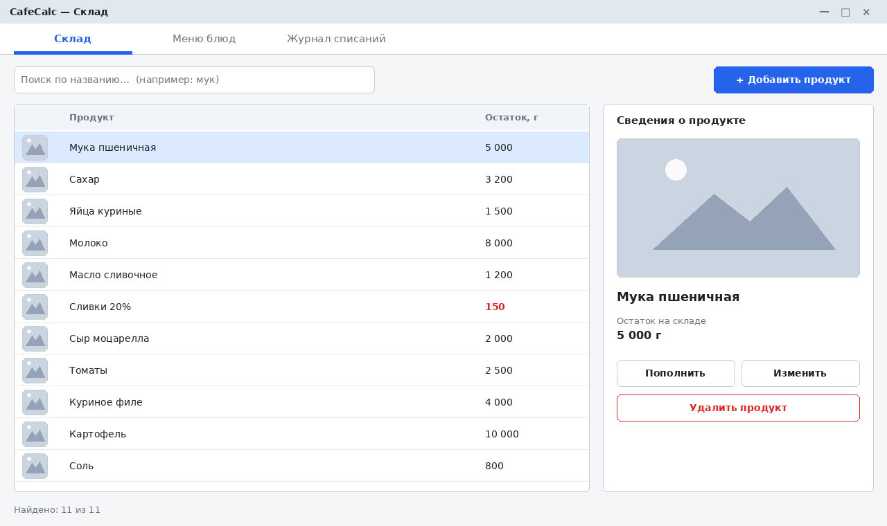
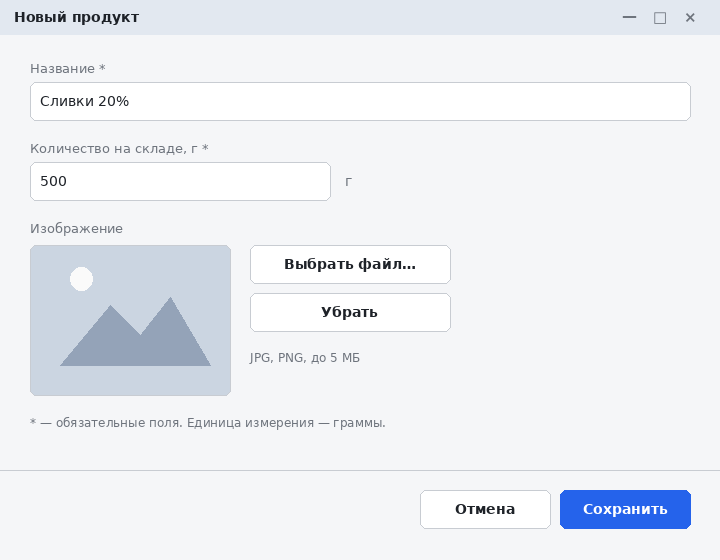
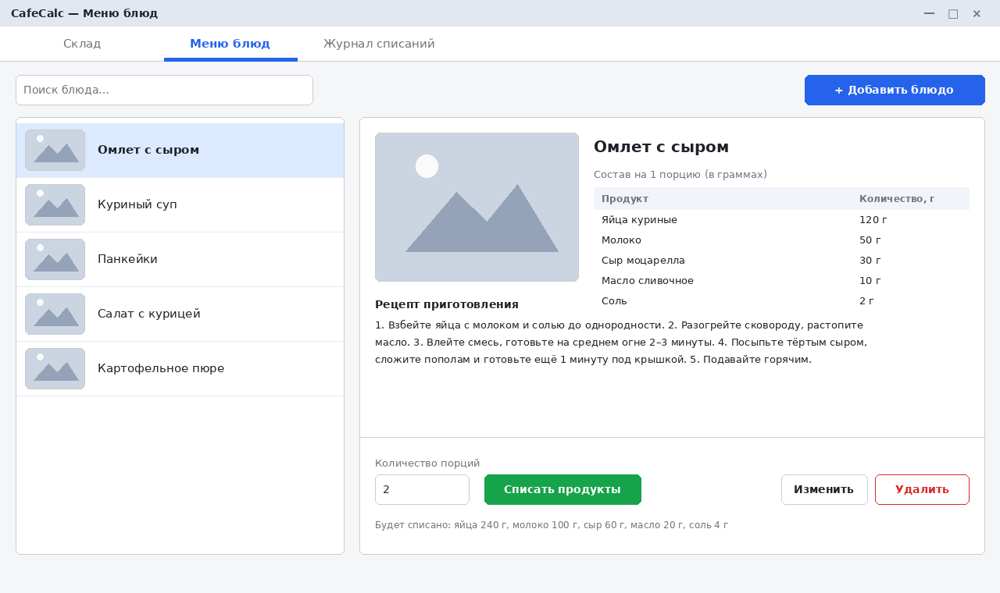

# Спецификация требований к ПО

Для CafeCalc — автоматизированной системы учёта продуктов и готовых блюд кафе

Версия 0.1

Подготовил Пастухов Максим Викторович, гр. 450501

БГУИР, кафедра кафедра электронных вычислительных машин

03.11.2026

## Оглавление

<!-- TOC -->
* [1. Введение](#1-introduction)
  * [1.1 Назначение документа](#11-document-purpose)
  * [1.2 Область применения продукта](#12-product-scope)
  * [1.3 Определения, акронимы и сокращения](#13-definitions-acronyms-and-abbreviations)
  * [1.4 Ссылки](#14-references)
  * [1.5 Обзор документа](#15-document-overview)
* [2. Обзор продукта](#2-product-overview)
  * [2.1 Перспектива продукта](#21-product-perspective)
  * [2.2 Функции продукта](#22-product-functions)
  * [2.3 Ограничения продукта](#23-product-constraints)
  * [2.4 Характеристики пользователей](#24-user-characteristics)
  * [2.5 Допущения и зависимости](#25-assumptions-and-dependencies)
  * [2.6 Распределение требований](#26-apportioning-of-requirements)
* [3. Требования](#3-requirements)
  * [3.1 Внешние интерфейсы](#31-external-interfaces)
    * [3.1.1 Пользовательские интерфейсы](#311-user-interfaces)
    * [3.1.2 Аппаратные интерфейсы](#312-hardware-interfaces)
    * [3.1.3 Программные интерфейсы](#313-software-interfaces)
  * [3.2 Функциональные требования](#32-functional)
  * [3.3 Качество обслуживания](#33-quality-of-service)
    * [3.3.1 Производительность](#331-performance)
    * [3.3.2 Безопасность](#332-security)
    * [3.3.3 Надёжность](#333-reliability)
    * [3.3.4 Доступность](#334-availability)
    * [3.3.5 Наблюдаемость](#335-observability)
  * [3.4 Соответствие стандартам](#34-compliance)
  * [3.5 Проектирование и реализация](#35-design-and-implementation)
    * [3.5.1 Установка](#351-installation)
    * [3.5.2 Сборка и поставка](#352-build-and-delivery)
    * [3.5.3 Распределение](#353-distribution)
    * [3.5.4 Сопровождаемость](#354-maintainability)
    * [3.5.5 Повторное использование](#355-reusability)
    * [3.5.6 Переносимость](#356-portability)
    * [3.5.7 Стоимость](#357-cost)
    * [3.5.8 Сроки](#358-deadline)
    * [3.5.9 Доказательство концепции](#359-proof-of-concept)
    * [3.5.10 Управление изменениями](#3510-change-management)
  * [3.6 ИИ/МО](#36-aiml)
* [4. Верификация](#4-verification)
* [5. Приложения](#5-appendixes)
<!-- TOC -->

## История изменений

| Name | Date | Reason For Changes | Version |
|------|------|--------------------|---------|
| Пастухов Максим Викторович | 03.11.2026 | Первая версия бизнес-требований по результатам беседы с Заказчиком | 0.1 |

---

## 1. Введение {#1-introduction}

Документ описывает требования к настольному приложению CafeCalc, которое автоматизирует складской учёт продуктов кафе и учёт приготовленных блюд. Приложение хранит данные о продуктах и их остатках (в граммах), позволяет быстро находить продукт по названию, вести меню блюд с изображениями и текстовыми рецептами и одной кнопкой списывать со склада продукты, израсходованные на приготовление выбранного блюда. Подробности вынесены в разделы 2–4.

### 1.1 Назначение документа {#11-document-purpose}

Документ фиксирует, **что** должна делать система CafeCalc, а не то, как она будет реализована. Он служит единым согласованным описанием ожиданий Заказчика для разработчика (проектирование и реализация), тестировщика (построение тестов по разделу 4) и Заказчика (приёмка). Документ является основой для последующих лабораторных работ курса (проектирование, реализация, тестирование) и ведётся в репозитории вместе с кодом.

### 1.2 Область применения продукта {#12-product-scope}

**Продукт:** CafeCalc, версия 1.0 (первый релиз).

**Назначение.** Заменить бумажный или табличный учёт в небольшом кафе единым приложением, где сотрудник видит актуальные остатки продуктов, знает состав и рецепт каждого блюда и в один клик списывает продукты по приготовленному блюду.

**Бизнес-цели:**

- BG-1: сократить время поиска информации о продукте и его остатке (поиск по названию, выбор из списка);
- BG-2: исключить ошибки ручного пересчёта расхода продуктов (автоматическое списание по составу блюда);
- BG-3: хранить рецепты и фотографии блюд в одном месте, чтобы блюдо готовилось одинаково любым сотрудником;
- BG-4: снизить риск ухода склада «в минус» (проверка остатков перед списанием).

**Входит в область применения:** учёт продуктов и остатков; поиск и выбор продукта; отдельное окно ввода нового продукта; изображения продуктов и блюд; меню блюд с составом в граммах и текстовым рецептом; списание продуктов по блюду; журнал списаний.

**Не входит в область применения (версия 1.0):** учёт продаж, цен и выручки; расчёт себестоимости; закупки и поставщики; кассовые операции; многопользовательский и сетевой режим; учёт в единицах, отличных от граммов (штуки, литры, ложки); мобильная и веб-версия; интеграция с внешними сервисами.

### 1.3 Определения, акронимы и сокращения {#13-definitions-acronyms-and-abbreviations}

| Term | Definition |
|------|------------|
| API | Application Programming Interface — набор определений и протоколов для создания и интеграции прикладного ПО |
| CRUD | Create, Read, Update, Delete — базовые операции над данными |
| GUI | Graphical User Interface — графический интерфейс пользователя |
| SRS | Software Requirements Specification — документ, описывающий назначение, требования и характер ПО |
| UI | User Interface — визуальная часть приложения, через которую пользователь взаимодействует с ПО |
| БД | База данных |
| Блюдо | Позиция меню кафе, имеющая название, изображение, состав и рецепт |
| Журнал списаний | Список выполненных операций списания продуктов со склада |
| Остаток | Количество продукта на складе, выраженное в граммах |
| Порция | Одна единица приготовленного блюда; состав блюда задаётся на 1 порцию |
| Продукт | Складская позиция (ингредиент) с названием, остатком и изображением |
| Рецепт | Текстовое описание порядка приготовления блюда |
| Склад | Совокупность всех продуктов и их остатков, хранимых в БД |
| Списание | Уменьшение остатков продуктов на величину расхода, необходимого для приготовления заданного числа порций блюда |
| Состав блюда | Перечень продуктов с количеством в граммах на 1 порцию |

### 1.4 Ссылки {#14-references}

| № | Документ | Владелец | Версия/дата | Расположение | Тип |
|---|----------|----------|-------------|--------------|-----|
| 1 | Требования ЖЦРПО 3 лаба (требования Заказчика) | Заказчик | 04.11.2026 | `Требования_ЖЦРПО_3_лаба.txt` | Нормативный |
| 2 | Лабораторная работа №3 «Разработка и документирование бизнес-требований» | кафедра, БГУИР | — | `Лабораторная_работа_3.pdf` | Справочный |
| 3 | Шаблон SRS | репозиторий курса | — | `srs/srs-template.md` | Нормативный |
| 4 | Мокапы интерфейса на SysML v2 (исходники) | Автор SRS | 0.1 | `srs/sysml/` | Справочный |
| 5 | Изображения мокапов (PNG) | Автор SRS | 0.1 | `srs/img/` | Справочный |
| 6 | ISO/IEC/IEEE 29148:2018, Requirements engineering | ISO/IEC/IEEE | 2018 | — | Справочный |

### 1.5 Обзор документа {#15-document-overview}

Раздел 2 описывает контекст продукта, пользователей, ограничения и допущения. Раздел 3 содержит проверяемые требования с идентификаторами `REQ-[AREA]-[NNN]`; в нём используются ключевые слова «должен» (обязательно), «следует» (желательно) и «может» (необязательно). Раздел 4 сопоставляет каждое требование с методом проверки. Раздел 5 содержит словарь данных, SysML v2-модель и перечень мокапов. Все изменения документа фиксируются в таблице «История изменений» и в истории коммитов репозитория.

---

## 2. Обзор продукта {#2-product-overview}

### 2.1 Перспектива продукта {#21-product-perspective}

CafeCalc — новый самостоятельный продукт, не заменяющий существующую информационную систему и не входящий в состав более крупной. Приложение работает автономно на одном компьютере сотрудника кафе, не требует подключения к сети и внешних сервисов. Все данные хранятся в локальной БД; изображения — в файлах в папке данных приложения. Владелец продукта — Заказчик (владелец/управляющий кафе). SLA не определяются; поддержка осуществляется разработчиком в рамках учебного проекта.

Контекст системы:

```
 Сотрудник кафе ──(GUI)──► [ CafeCalc ] ──► Локальная БД (продукты, блюда, журнал)
                                      └──► Папка изображений (файлы JPG/PNG)
```

### 2.2 Функции продукта {#22-product-functions}

1. **Учёт продуктов:** хранение названия, остатка в граммах и изображения продукта; пополнение, изменение, удаление.
2. **Поиск и выбор продукта:** поиск по названию, выбор продукта из списка, просмотр сведений.
3. **Ввод новых продуктов:** отдельное окно с проверкой введённых данных.
4. **Изображения:** привязка изображений к продуктам и блюдам.
5. **Меню блюд:** ведение списка блюд, состав в граммах на 1 порцию.
6. **Рецепты:** текстовый рецепт приготовления для каждого блюда.
7. **Списание:** выбор блюда и числа порций, кнопка «Списать» уменьшает остатки продуктов; защита от ухода в минус.
8. **Журнал списаний:** история выполненных списаний.

### 2.3 Ограничения продукта {#23-product-constraints}

| ID | Ограничение | Тип |
|----|-------------|-----|
| CON-1 | Продукт должен быть реализован на языке C# | Внешнее, обязательное |
| CON-2 | Продукт должен разрабатываться в JetBrains Rider | Внешнее, обязательное |
| CON-3 | Продукт должен быть десктопным приложением | Внешнее, обязательное |
| CON-4 | Продукт должен использовать базу данных для хранения продуктов, блюд и журнала | Внешнее, обязательное |
| CON-5 | Все количества продуктов должны выражаться только в весе и объёме; ложки и другие бытовые меры не допускаются | Внешнее, обязательное |
| CON-6 | Ввод нового продукта должен выполняться в отдельном окне | Внешнее, обязательное |
| CON-7 | Продукты и блюда должны иметь изображения | Внешнее, обязательное |
| CON-8 | Каждое блюдо должно иметь текстовый рецепт приготовления | Внешнее, обязательное |
| CON-9 | Язык интерфейса — русский | Внутреннее, обязательное |

### 2.4 Характеристики пользователей {#24-user-characteristics}

В системе предусмотрена **одна роль** — **Сотрудник кафе** (повар, кладовщик, администратор). Авторизация не требуется; все функции доступны любому пользователю приложения.

| Атрибут | Описание |
|---------|----------|
| Подготовка | Базовые навыки работы с Windows-приложениями; специальной ИТ-подготовки нет |
| Частота использования | Ежедневно, многократно в течение смены |
| Цели | Быстро узнать остаток, добавить новый продукт, посмотреть рецепт, списать продукты по приготовленному блюду |
| Доступность | Крупные кнопки, читаемый шрифт, работа с клавиатуры и мыши; кафе — рабочая среда с высоким темпом |
| Локализация | Русский язык |

### 2.5 Допущения и зависимости {#25-assumptions-and-dependencies}

| ID | Допущение / зависимость | Влияние, если окажется неверным |
|----|--------------------------|----------------------------------|
| A-1 | Приложение используется на одном рабочем месте | При необходимости нескольких рабочих мест потребуется серверная БД и пересмотр архитектуры |
| A-2 | Компьютер работает под Windows 10/11 | Потребуется кроссплатформенный UI-стек (например, Avalonia) |
| A-3 | Все продукты можно учитывать в граммах (в том числе жидкости и штучные: яйца, молоко) | Потребуется ввести другие единицы измерения |
| A-4 | Состав блюда задаётся на 1 порцию и не меняется между порциями | Потребуется масштабирование и допуски на порцию |
| A-5 | Одно блюдо — одна порция одного размера | Потребуется поддержка размеров порций |
| A-6 | Данные не содержат персональной или коммерчески критичной информации | Потребуется шифрование и разграничение доступа |
| D-1 | Зависимость от .NET 8 Runtime, SQLite и библиотек доступа к БД | При их отсутствии на ПК приложение не запустится; библиотеки включаются в поставку |

### 2.6 Распределение требований {#26-apportioning-of-requirements}

| Компонент / инкремент | Требования |
|-----------------------|------------|
| Инкремент 1 — Склад | REQ-FUNC-001…009, REQ-INT-001…003 |
| Инкремент 2 — Меню и рецепты | REQ-FUNC-010…013 |
| Инкремент 3 — Списание и журнал | REQ-FUNC-014…016 |
| Сквозные (все инкременты) | REQ-PERF, REQ-SEC, REQ-REL, REQ-AVAIL, REQ-OBS, REQ-COMP, REQ-INST, REQ-BUILD, REQ-MAINT, REQ-PORT |
| Отложено (версия 2.0) | Оповещение о низком остатке; учёт цен и себестоимости; экспорт отчётов; роли и авторизация; другие единицы измерения |

---

## 3. Требования {#3-requirements}

Идентификаторы имеют формат `REQ-[AREA]-[NNN]`. Метод верификации указан в каждом требовании, сводная матрица — в разделе 4.

### 3.1 Внешние интерфейсы {#31-external-interfaces}

#### 3.1.1 Пользовательские интерфейсы {#311-user-interfaces}

Мокапы интерфейса разработаны на языке SysML v2 (текстовая нотация, файлы в `srs/sysml/`): [00_ui_library.sysml](sysml/00_ui_library.sysml) — библиотека элементов GUI; [01_stock_screen.sysml](sysml/01_stock_screen.sysml) — вкладка «Склад»; [02_add_product_window.sysml](sysml/02_add_product_window.sysml) — окно «Новый продукт» (ввод и ошибки); [03_menu_screen.sysml](sysml/03_menu_screen.sysml) — вкладка «Меню блюд» и списание; [04_add_dish_window.sysml](sysml/04_add_dish_window.sysml) — окно «Новое блюдо»; [05_writeoff_shortage_dialog.sysml](sysml/05_writeoff_shortage_dialog.sysml) — сообщение о нехватке продуктов. Изображения в PNG — визуальное представление тех же экранов.

Макеты окон: [главное окно «Склад»](img/01_main_window.png), [ввод продукта](img/02_add_product_window.png), [ошибки ввода](img/03_add_product_validation.png), [меню блюд](img/04_menu_window.png), [ввод блюда](img/06_add_dish_window.png), [нехватка продуктов при списании](img/05_writeoff_shortage.png).







**REQ-INT-001 — Структура пользовательского интерфейса**
- **Statement:** Главное окно должно содержать вкладки «Склад», «Меню блюд» и «Журнал списаний». Ввод нового продукта и ввод/редактирование блюда должны выполняться в отдельных модальных окнах.
- **Rationale:** Заказчик требует отдельное окно для ввода новых продуктов; единая структура упрощает обучение.
- **Acceptance Criteria:** (1) в главном окне присутствуют три вкладки; (2) кнопка «Добавить продукт» открывает отдельное окно; (3) пока окно открыто, главное окно недоступно для ввода.
- **Verification Method:** Demonstration
- **More Information:** Макеты 01, 02, 04, 06.

**REQ-INT-002 — Общие правила интерфейса**
- **Statement:** Интерфейс должен быть на русском языке; все количества должны отображаться в граммах с обозначением «г»; минимальное разрешение окна — 1280×720; ошибки ввода должны отображаться рядом с полем красным текстом; пустые списки должны сопровождаться поясняющим сообщением.
- **Rationale:** Единообразие и исключение путаницы в единицах измерения (CON-5).
- **Acceptance Criteria:** в окнах отсутствуют надписи на других языках и единицы, отличные от «г»; при пустом складе выводится сообщение «Продукты не добавлены».
- **Verification Method:** Inspection
- **More Information:** Макет 03.

**REQ-INT-003 — Горячие клавиши**
- **Statement:** Приложению следует устанавливать фокус на поле поиска при открытии вкладки «Склад», а также поддерживать сочетания клавиш: Ctrl+F — переход к поиску, Esc — закрытие модального окна, Enter — подтверждение формы.
- **Rationale:** Ускорение работы в условиях высокого темпа.
- **Acceptance Criteria:** перечисленные клавиши выполняют указанные действия.
- **Verification Method:** Test
- **More Information:** —

#### 3.1.2 Аппаратные интерфейсы {#312-hardware-interfaces}

Специальные аппаратные интерфейсы не требуются. Ввод осуществляется стандартной клавиатурой и мышью; вывод — на монитор. Подключение сканеров штрихкодов, весов и принтеров не предусмотрено.

#### 3.1.3 Программные интерфейсы {#313-software-interfaces}

**REQ-INT-004 — Локальная база данных**
- **Statement:** Система должна хранить продукты, блюда, составы блюд и журнал списаний во встраиваемой реляционной БД в одном файле, не требующей отдельного сервера.
- **Rationale:** CON-4, A-1; простота установки в кафе.
- **Acceptance Criteria:** после перезапуска приложения все введённые данные сохранены; для работы не требуется установка СУБД.
- **Verification Method:** Test
- **More Information:** —

**REQ-INT-005 — Хранение изображений**
- **Statement:** При выборе изображения система должна копировать файл в папку данных приложения и сохранять в БД относительный путь; поддерживаемые форматы — JPG и PNG, размер — не более 5 МБ.
- **Rationale:** Изображение должно отображаться даже после удаления или перемещения исходного файла.
- **Acceptance Criteria:** после удаления исходного файла изображение продолжает отображаться; файл неподдерживаемого формата или более 5 МБ отклоняется с сообщением об ошибке.
- **Verification Method:** Test
- **More Information:** —

Внешние сервисы и сетевые API не используются.

### 3.2 Функциональные требования {#32-functional}

#### Учёт продуктов

**REQ-FUNC-001 — Список продуктов**
- **Statement:** Система должна отображать на вкладке «Склад» список всех продуктов с изображением, названием и остатком в граммах, отсортированный по названию.
- **Rationale:** Основная функция учёта продуктов (BG-1).
- **Acceptance Criteria:** при открытии вкладки отображаются все продукты из БД; пустой склад показывает сообщение (REQ-INT-002); продукты с остатком менее 300 г выделены красным.
- **Verification Method:** Test
- **More Information:** Макет 01.

**REQ-FUNC-002 — Поиск по названию**
- **Statement:** Система должна фильтровать список продуктов по введённой в поле поиска строке: совпадение по подстроке в названии, без учёта регистра; фильтрация должна выполняться по мере ввода.
- **Rationale:** Быстрый поиск продукта по названию (требование Заказчика).
- **Acceptance Criteria:** при вводе «мук» отображается «Мука пшеничная»; при вводе «МУК» результат тот же; при очистке поля показываются все продукты; при отсутствии совпадений выводится «Ничего не найдено».
- **Verification Method:** Test
- **More Information:** Счётчик «Найдено: N из M» отображается под списком.

**REQ-FUNC-003 — Выбор продукта из списка**
- **Statement:** Система должна позволять выбрать продукт щелчком в списке и отображать в правой панели его изображение, название и остаток.
- **Rationale:** Выбор продукта из списка (требование Заказчика).
- **Acceptance Criteria:** после выбора строки панель «Сведения о продукте» отображает данные именно этого продукта; при отсутствии выбора кнопки «Пополнить», «Изменить», «Удалить» недоступны.
- **Verification Method:** Test
- **More Information:** Макет 01.

**REQ-FUNC-004 — Добавление нового продукта**
- **Statement:** Система должна предоставлять отдельное окно «Новый продукт», открываемое кнопкой «Добавить продукт», с полями «Название», «Количество на складе, г» и «Изображение» и кнопками «Сохранить» и «Отмена».
- **Rationale:** Отдельное окно для ввода новых продуктов (требование Заказчика).
- **Acceptance Criteria:** после «Сохранить» окно закрывается, продукт появляется в списке и в БД; после «Отмена» данные не сохраняются.
- **Verification Method:** Test
- **More Information:** Макет 02.

**REQ-FUNC-005 — Проверка вводимых данных продукта**
- **Statement:** Система должна проверять данные нового или изменяемого продукта: название — непустое, не более 100 символов, уникальное без учёта регистра; количество — целое неотрицательное число граммов не более 10 000 000. При ошибке сохранение не должно выполняться, рядом с полем должно выводиться сообщение.
- **Rationale:** Защита целостности данных, единица измерения — только граммы (CON-5).
- **Acceptance Criteria:** значения «», «Мука пшеничная» (дубликат), «12,5», «-5», «abc» отклоняются с сообщением; значения «Соль», «0» принимаются.
- **Verification Method:** Test
- **More Information:** Макет 03.

**REQ-FUNC-006 — Изображение продукта**
- **Statement:** Система должна позволять выбрать изображение продукта при создании и изменении, отображать его в списке (миниатюра) и в панели сведений; при отсутствии изображения должна отображаться стандартная картинка-заглушка.
- **Rationale:** CON-7.
- **Acceptance Criteria:** выбранное изображение отображается в списке и панели; для продукта без изображения показывается заглушка; ограничения формата и размера — по REQ-INT-005.
- **Verification Method:** Test
- **More Information:** —

**REQ-FUNC-007 — Пополнение и изменение продукта**
- **Statement:** Система должна позволять пополнить остаток выбранного продукта на указанное число граммов (кнопка «Пополнить») и изменить название, остаток и изображение (кнопка «Изменить») с проверкой по REQ-FUNC-005.
- **Rationale:** Остатки на складе меняются при поступлении продуктов; ошибки ввода необходимо исправлять.
- **Acceptance Criteria:** при пополнении остатка 5 000 г на 500 г итоговый остаток равен 5 500 г; пополнение на 0, отрицательное или нечисловое значение отклоняется.
- **Verification Method:** Test
- **More Information:** —

**REQ-FUNC-008 — Удаление продукта**
- **Statement:** Система должна позволять удалить выбранный продукт после подтверждения. Продукт, входящий в состав хотя бы одного блюда, удалять не должно; пользователю должно выводиться сообщение с перечнем таких блюд.
- **Rationale:** Удаление продукта не должно ломать составы блюд и рецепты.
- **Acceptance Criteria:** продукт без связей удаляется после подтверждения; продукт из состава блюда не удаляется, выводится список блюд.
- **Verification Method:** Test
- **More Information:** —

**REQ-FUNC-009 — Единицы измерения**
- **Statement:** Система должна хранить и отображать все количества продуктов только в граммах как целые числа; ввод других единиц (ложки, штуки, миллилитры) не должен поддерживаться.
- **Rationale:** CON-5.
- **Acceptance Criteria:** ни в одном окне нет выбора другой единицы; при вводе значения с единицей, например «2 ложки», ввод отклоняется.
- **Verification Method:** Inspection
- **More Information:** Допущение A-3.

#### Меню блюд и рецепты

**REQ-FUNC-010 — Список блюд**
- **Statement:** Система должна отображать на вкладке «Меню блюд» список блюд с изображением и названием, поддерживать поиск блюда по названию аналогично REQ-FUNC-002 и выбор блюда из списка.
- **Rationale:** Меню с выбором блюда/рецепта (требование Заказчика).
- **Acceptance Criteria:** все блюда из БД отображаются; поиск и выбор работают; при выборе в правой части показывается карточка блюда.
- **Verification Method:** Test
- **More Information:** Макет 04.

**REQ-FUNC-011 — Добавление и изменение блюда**
- **Statement:** Система должна предоставлять отдельное окно для создания и редактирования блюда с полями: название (уникальное, до 100 символов), изображение, состав (не менее одного продукта; продукт выбирается из списка склада, количество — целое число граммов на 1 порцию, больше 0) и текстовый рецепт (непустой).
- **Rationale:** Без ввода блюд невозможны меню и списание.
- **Acceptance Criteria:** блюдо с пустым названием, без состава, с нулевым количеством продукта или без рецепта не сохраняется; один продукт не может быть добавлен в состав дважды; корректное блюдо сохраняется и отображается в меню.
- **Verification Method:** Test
- **More Information:** Макет 06. Блюдо можно удалить с подтверждением; записи журнала при этом сохраняются.

**REQ-FUNC-012 — Карточка блюда**
- **Statement:** Система должна отображать для выбранного блюда его изображение, название, состав на 1 порцию (продукт и граммы) и рецепт приготовления.
- **Rationale:** BG-3; CON-7.
- **Acceptance Criteria:** все четыре элемента отображаются; для блюда без изображения показывается заглушка.
- **Verification Method:** Demonstration
- **More Information:** Макет 04.

**REQ-FUNC-013 — Текстовый рецепт**
- **Statement:** Система должна хранить для каждого блюда текстовый рецепт (многострочный текст до 5 000 символов) и показывать его в карточке блюда с сохранением переносов строк.
- **Rationale:** CON-8.
- **Acceptance Criteria:** рецепт длиной 5 000 символов сохраняется и отображается полностью; рецепт длиннее лимита отклоняется с сообщением.
- **Verification Method:** Test
- **More Information:** —

#### Списание продуктов

**REQ-FUNC-014 — Списание продуктов по блюду**
- **Statement:** Система должна позволять выбрать блюдо, указать число порций (целое от 1 до 999) и нажать кнопку «Списать», после чего уменьшить остаток каждого продукта состава на (граммы на порцию × число порций). Перед нажатием кнопки система должна показывать рассчитанный расход по каждому продукту.
- **Rationale:** Автоматизация списания; BG-2.
- **Acceptance Criteria:** для «Омлет с сыром» (яйца 120 г, молоко 50 г, сыр 30 г, масло 10 г, соль 2 г) при 2 порциях остатки уменьшаются на 240, 100, 60, 20 и 4 г соответственно; отображаемый расход совпадает со списанным.
- **Verification Method:** Test
- **More Information:** Макет 04.

**REQ-FUNC-015 — Контроль остатков при списании**
- **Statement:** Система не должна выполнять списание, если остаток хотя бы одного продукта меньше требуемого количества. В этом случае должно выводиться сообщение с перечнем продуктов, требуемым количеством, остатком и нехваткой; остатки не должны изменяться ни по одному продукту. Списание должно выполняться как единая неделимая операция.
- **Rationale:** BG-4; исключение частичного списания и отрицательных остатков.
- **Acceptance Criteria:** при остатке сыра 40 г и необходимых 60 г ни один остаток не изменился, выведено сообщение с нехваткой 20 г; остаток никогда не становится отрицательным; при сбое во время списания остатки остаются прежними.
- **Verification Method:** Test
- **More Information:** Макет 05.

**REQ-FUNC-016 — Журнал списаний**
- **Statement:** Система должна фиксировать каждое успешное списание (дата и время, блюдо, число порций, список продуктов с граммами) и отображать записи на вкладке «Журнал списаний» в порядке от новых к старым с поиском по названию блюда.
- **Rationale:** Прослеживаемость расхода продуктов.
- **Acceptance Criteria:** после списания в журнале появляется запись с корректными данными; записи сохраняются после перезапуска и после удаления блюда или продукта (названия сохраняются в записи).
- **Verification Method:** Test
- **More Information:** Журнал доступен только для просмотра.

### 3.3 Качество обслуживания {#33-quality-of-service}

#### 3.3.1 Производительность {#331-performance}

**REQ-PERF-001 — Время отклика**
- **Statement:** При наличии в БД до 5 000 продуктов и 500 блюд поиск (REQ-FUNC-002) должен обновлять список не более чем за 300 мс; списание (REQ-FUNC-014) должно завершаться не более чем за 1 с.
- **Rationale:** Работа в условиях высокого темпа кафе.
- **Acceptance Criteria:** замеры на эталонном ПК (4 ГБ ОЗУ, двухъядерный процессор, HDD) не превышают указанные значения.
- **Verification Method:** Test
- **More Information:** —

**REQ-PERF-002 — Запуск и ресурсы**
- **Statement:** Приложение должно запускаться и отображать главное окно не более чем за 5 с и использовать не более 300 МБ ОЗУ при указанном объёме данных.
- **Rationale:** Скромные характеристики компьютеров в кафе.
- **Acceptance Criteria:** замеры времени запуска и потребления памяти в пределах указанных значений.
- **Verification Method:** Test
- **More Information:** —

#### 3.3.2 Безопасность {#332-security}

**REQ-SEC-001 — Целостность данных**
- **Statement:** Система должна исключать некорректные данные в БД: отрицательные остатки, дубликаты названий, блюда без состава, ссылки состава на несуществующие продукты.
- **Rationale:** Защита целостности данных учёта.
- **Acceptance Criteria:** попытки создать такие данные через интерфейс отклоняются; на уровне БД заданы ограничения (уникальность, внешние ключи, CHECK остатка ≥ 0).
- **Verification Method:** Test
- **More Information:** —

**REQ-SEC-002 — Доступ и конфиденциальность**
- **Statement:** Система не должна хранить и передавать персональные данные; сетевые соединения устанавливать не должна; авторизация не требуется (единственная роль, см. 2.4).
- **Rationale:** Минимизация поверхности атаки; A-6.
- **Acceptance Criteria:** при анализе сетевой активности приложение не устанавливает соединений.
- **Verification Method:** Analysis
- **More Information:** Доступ к данным ограничивается средствами учётной записи Windows.

#### 3.3.3 Надёжность {#333-reliability}

**REQ-REL-001 — Атомарность операций**
- **Statement:** Операции, изменяющие несколько записей (списание, сохранение блюда с составом), должны выполняться в транзакции: либо применяются полностью, либо не применяются вовсе.
- **Rationale:** Исключение частичного списания.
- **Acceptance Criteria:** при принудительном прерывании приложения во время списания после перезапуска остатки соответствуют состоянию либо до, либо после операции целиком.
- **Verification Method:** Test
- **More Information:** Связано с REQ-FUNC-015.

**REQ-REL-002 — Резервное копирование**
- **Statement:** Система должна предоставлять функцию создания резервной копии файла БД и изображений в указанную пользователем папку и восстановления из неё.
- **Rationale:** Защита от потери данных при сбое диска.
- **Acceptance Criteria:** после восстановления из копии данные совпадают с состоянием на момент копирования.
- **Verification Method:** Test
- **More Information:** Функция «следует» (приоритет средний).

**REQ-REL-003 — Обработка ошибок**
- **Statement:** Система не должна завершаться аварийно при ошибках доступа к файлам, повреждённом или отсутствующем изображении; в этих случаях должно выводиться сообщение на русском языке, для изображения — заглушка.
- **Rationale:** Устойчивость к ошибкам окружения.
- **Acceptance Criteria:** при удалении файла изображения из папки данных приложение продолжает работу и показывает заглушку.
- **Verification Method:** Test
- **More Information:** —

#### 3.3.4 Доступность {#334-availability}

**REQ-AVAIL-001 — Автономная работа**
- **Statement:** Приложение должно быть доступно для работы в любое время, не зависеть от сети и внешних сервисов; после аварийного завершения должно запускаться штатно без ручного восстановления данных.
- **Rationale:** Кафе работает без перерывов; A-1.
- **Acceptance Criteria:** приложение запускается и работает при отключённой сети; повторный запуск после аварийного завершения успешен.
- **Verification Method:** Test
- **More Information:** Метрики SLA не вводятся.

#### 3.3.5 Наблюдаемость {#335-observability}

**REQ-OBS-001 — Журнал событий приложения**
- **Statement:** Система должна вести текстовый файл журнала в папке данных приложения: запуск и завершение, необработанные ошибки (с описанием и стеком), операции списания; персональные данные в журнал не пишутся; хранится не более 30 дней.
- **Rationale:** Диагностика проблем у Заказчика.
- **Acceptance Criteria:** после ошибки в файле присутствует запись; записи старше 30 дней удаляются.
- **Verification Method:** Inspection
- **More Information:** Отличается от журнала списаний (REQ-FUNC-016).

### 3.4 Соответствие стандартам {#34-compliance}

**REQ-COMP-001 — Лицензии и оформление**
- **Statement:** Сторонние библиотеки должны иметь лицензии, допускающие бесплатное использование в учебном проекте; их перечень с лицензиями должен быть приведён в документации. Изображения-заглушки не должны нарушать авторские права.
- **Rationale:** Законность использования компонентов.
- **Acceptance Criteria:** в репозитории присутствует файл со списком библиотек и лицензий.
- **Verification Method:** Inspection
- **More Information:** Специальных отраслевых или регуляторных требований не предъявляется.

### 3.5 Проектирование и реализация {#35-design-and-implementation}

#### 3.5.1 Установка {#351-installation}

**REQ-INST-001 — Установка и удаление**
- **Statement:** Приложение должно устанавливаться на Windows 10/11 (x64) копированием папки или установщиком без прав разработчика и без отдельной установки СУБД; при первом запуске должна автоматически создаваться пустая БД. Удаление приложения не должно затрагивать пользовательские данные без подтверждения.
- **Rationale:** Простота внедрения в кафе.
- **Acceptance Criteria:** на «чистой» Windows 10 приложение запускается после установки не более чем за 5 шагов; первый запуск создаёт БД.
- **Verification Method:** Demonstration
- **More Information:** —

#### 3.5.2 Сборка и поставка {#352-build-and-delivery}

**REQ-BUILD-001 — Воспроизводимая сборка**
- **Statement:** Проект должен собираться из исходного кода в репозитории одной командой (`dotnet build` или сборка в Rider) без ручной настройки; зависимости должны подключаться через NuGet с фиксированными версиями.
- **Rationale:** Воспроизводимость и трассируемость.
- **Acceptance Criteria:** сборка на чистой машине с .NET SDK завершается без ошибок.
- **Verification Method:** Demonstration
- **More Information:** —

#### 3.5.3 Распределение {#353-distribution}

Распределённое развёртывание не предусмотрено: приложение и БД размещаются на одном компьютере (A-1).

#### 3.5.4 Сопровождаемость {#354-maintainability}

**REQ-MAINT-001 — Структура кода**
- **Statement:** Код должен быть разделён на слои (интерфейс, логика, доступ к данным), соответствовать соглашениям C# (именование, форматирование), а бизнес-логика (поиск, расчёт расхода, проверка остатков) должна быть покрыта модульными тестами.
- **Rationale:** Упрощение сопровождения и тестирования.
- **Acceptance Criteria:** слои разнесены по проектам или пространствам имён; модульные тесты выполняются и проходят.
- **Verification Method:** Inspection
- **More Information:** —

#### 3.5.5 Повторное использование {#355-reusability}

Специальных требований нет. Слой бизнес-логики следует отделять от UI, чтобы при необходимости использовать его в другом интерфейсе.

#### 3.5.6 Переносимость {#356-portability}

**REQ-PORT-001 — Платформа**
- **Statement:** Приложение должно работать на Windows 10/11 x64. Поддержка Linux/macOS в версии 1.0 не требуется.
- **Rationale:** A-2; десктопное приложение (CON-3).
- **Acceptance Criteria:** приложение запускается на Windows 10 и Windows 11.
- **Verification Method:** Test
- **More Information:** —

#### 3.5.7 Стоимость {#357-cost}

**REQ-COST-001 — Бюджет**
- **Statement:** Разработка и эксплуатация не должны требовать платных лицензий и сторонних сервисов (учебный проект; используются бесплатные .NET, SQLite и версия JetBrains Rider для учебных целей).
- **Rationale:** Учебный проект без бюджета.
- **Acceptance Criteria:** в проекте нет платных зависимостей.
- **Verification Method:** Inspection
- **More Information:** —

#### 3.5.8 Сроки {#358-deadline}

**REQ-DEAD-001 — Этапы**
- **Statement:** Реализация должна вестись инкрементами, соответствующими 2.6: Инкремент 1 (Склад), 2 (Меню и рецепты), 3 (Списание и журнал). Сроки и даты определяются графиком лабораторных работ курса [уточнить у преподавателя].
- **Rationale:** Поэтапная поставка и обратная связь от Заказчика.
- **Acceptance Criteria:** по завершении каждого инкремента проводится демонстрация Заказчику.
- **Verification Method:** Demonstration
- **More Information:** Преподаватель может внести корректировки в любой момент (см. 3.5.10).

#### 3.5.9 Доказательство концепции {#359-proof-of-concept}

**REQ-POC-001 — Прототип интерфейса**
- **Statement:** До начала реализации должны быть подготовлены мокапы GUI на SysML v2 и согласованы с Заказчиком.
- **Rationale:** Снижение риска неверного понимания требований.
- **Acceptance Criteria:** мокапы просмотрены Заказчиком; замечания учтены или отклонены с обоснованием.
- **Verification Method:** Demonstration
- **More Information:** Технические PoC не требуются: используются стандартные технологии.

#### 3.5.10 Управление изменениями {#3510-change-management}

**REQ-CM-001 — Процесс изменений**
- **Statement:** Изменения требований должны вноситься в отдельной ветке репозитория через pull-request с обзором Заказчиком; каждое изменение должно фиксироваться в «Истории изменений» с увеличением версии документа; изменения идентификаторов требований — через суффикс `-[VER]`.
- **Rationale:** Прослеживаемость; требования лабораторной работы.
- **Acceptance Criteria:** в репозитории есть pull-request с комментариями Заказчика и записью в истории изменений.
- **Verification Method:** Inspection
- **More Information:** Корректировки преподавателя вносятся до конца текущего занятия.

### 3.6 ИИ/МО {#36-aiml}

Не применимо: система не содержит компонентов машинного обучения или ИИ. Подразделы 3.6.1–3.6.6 исключены.

---

## 4. Верификация {#4-verification}

| Requirement ID | Verification Method | Test/Artifact Link | Status | Evidence |
|----------------|---------------------|--------------------|--------|----------|
| REQ-INT-001 | Demonstration | tests/INT-001.md | Planned | |
| REQ-INT-002 | Inspection | tests/INT-002.md | Planned | |
| REQ-INT-003 | Test | tests/INT-003.md | Planned | |
| REQ-INT-004 | Test | tests/INT-004.md | Planned | |
| REQ-INT-005 | Test | tests/INT-005.md | Planned | |
| REQ-FUNC-001 | Test | tests/FUNC-001.md | Planned | |
| REQ-FUNC-002 | Test | tests/FUNC-002.md | Planned | |
| REQ-FUNC-003 | Test | tests/FUNC-003.md | Planned | |
| REQ-FUNC-004 | Test | tests/FUNC-004.md | Planned | |
| REQ-FUNC-005 | Test | tests/FUNC-005.md | Planned | |
| REQ-FUNC-006 | Test | tests/FUNC-006.md | Planned | |
| REQ-FUNC-007 | Test | tests/FUNC-007.md | Planned | |
| REQ-FUNC-008 | Test | tests/FUNC-008.md | Planned | |
| REQ-FUNC-009 | Inspection | tests/FUNC-009.md | Planned | |
| REQ-FUNC-010 | Test | tests/FUNC-010.md | Planned | |
| REQ-FUNC-011 | Test | tests/FUNC-011.md | Planned | |
| REQ-FUNC-012 | Demonstration | tests/FUNC-012.md | Planned | |
| REQ-FUNC-013 | Test | tests/FUNC-013.md | Planned | |
| REQ-FUNC-014 | Test | tests/FUNC-014.md | Planned | |
| REQ-FUNC-015 | Test | tests/FUNC-015.md | Planned | |
| REQ-FUNC-016 | Test | tests/FUNC-016.md | Planned | |
| REQ-PERF-001 | Test | tests/PERF-001.md | Planned | |
| REQ-PERF-002 | Test | tests/PERF-002.md | Planned | |
| REQ-SEC-001 | Test | tests/SEC-001.md | Planned | |
| REQ-SEC-002 | Analysis | tests/SEC-002.md | Planned | |
| REQ-REL-001 | Test | tests/REL-001.md | Planned | |
| REQ-REL-002 | Test | tests/REL-002.md | Planned | |
| REQ-REL-003 | Test | tests/REL-003.md | Planned | |
| REQ-AVAIL-001 | Test | tests/AVAIL-001.md | Planned | |
| REQ-OBS-001 | Inspection | tests/OBS-001.md | Planned | |
| REQ-COMP-001 | Inspection | docs/licenses.md | Planned | |
| REQ-INST-001 | Demonstration | tests/INST-001.md | Planned | |
| REQ-BUILD-001 | Demonstration | tests/BUILD-001.md | Planned | |
| REQ-MAINT-001 | Inspection | tests/MAINT-001.md | Planned | |
| REQ-PORT-001 | Test | tests/PORT-001.md | Planned | |
| REQ-COST-001 | Inspection | docs/licenses.md | Planned | |
| REQ-DEAD-001 | Demonstration | — | Planned | |
| REQ-POC-001 | Demonstration | srs/img/ | WIP | |
| REQ-CM-001 | Inspection | pull-request в репозитории | WIP | |

---

## 5. Приложения {#5-appendixes}

### 5.1 Открытые вопросы

| ID | Вопрос | Предлагаемое решение по умолчанию | Затронутые требования |
|----|--------|-----------------------------------|-----------------------|
| OQ-1 | Можно ли выполнить списание, если какого-то продукта не хватает (с уходом остатка в минус)? | Нет, списание отклоняется целиком, остатки не меняются | REQ-FUNC-015, REQ-REL-001, REQ-SEC-001 |
| OQ-2 | Допустимо ли учитывать в граммах и жидкие, и штучные продукты (молоко, яйца)? | Да, всё учитывается только в граммах | REQ-FUNC-009, REQ-INT-002 |
| OQ-3 | Можно ли удалить продукт, который входит в состав блюда? | Нет, показывать список блюд, в которых он используется | REQ-FUNC-008 |
| OQ-4 | Какие форматы изображений поддерживать, кроме JPG и PNG (WebP, GIF)? Какой максимальный размер? | Только JPG и PNG до 5 МБ, остальное — отклонять с сообщением | REQ-FUNC-006, REQ-INT-005 |
| OQ-5 | Нужна ли возможность отменить выполненное списание? Нужно ли редактировать журнал? | Нет, журнал только для просмотра, отмены списания нет | REQ-FUNC-016 |
| OQ-6 | Нужно ли фиксировать в журнале пополнения остатков (приходы продуктов)? | Нет, в версии 1.0 в журнал попадают только списания | REQ-FUNC-007, REQ-FUNC-016 |
| OQ-7 | Приемлемы ли пределы на объём данных (5000 продуктов, 500 блюд, рецепт до 5000 символов, 1–999 порций за одно списание)? | Принять указанные пределы, при превышении показывать понятную ошибку | REQ-PERF-001, REQ-FUNC-013, REQ-FUNC-014 |
| OQ-8 | Нужно ли форматирование текста рецепта (жирный, списки, шаги)? | Нет, простой текст с сохранением переносов строк | REQ-FUNC-013 |
| OQ-9 | Нужны ли в версии 1.0 резервное копирование и восстановление данных? | Да, ручное копирование в выбранную папку (приоритет «следует») | REQ-REL-002 |
| OQ-10 | Планируется ли работа нескольких сотрудников с одной базой одновременно (несколько рабочих мест)? | Нет, одно рабочее место, локальная БД | REQ-INT-004, REQ-AVAIL-001 |
| OQ-11 | Нужны ли авторизация и разные роли (повар, кладовщик, администратор)? | Нет, одна роль «Сотрудник кафе», без входа в систему | REQ-SEC-002 |
| OQ-12 | Нужна ли поддержка не только Windows (Linux, macOS)? | Нет, только Windows 10/11 x64 | REQ-PORT-001 |

### 5.2 Приложение B. Графические модели SysML v2

| № | Исходник SysML v2 | Изображение | Содержание | Требования |
|---|-------------------|-------------|------------|------------|
| — | [00_ui_library.sysml](sysml/00_ui_library.sysml) | — | Библиотека элементов GUI, строки данных, события | — |
| 1 | [01_stock_screen.sysml](sysml/01_stock_screen.sysml) | [01_main_window.png](img/01_main_window.png) | Вкладка «Склад»: поиск, список, сведения о продукте | FUNC-001…003, 006…008 |
| 2 | [02_add_product_window.sysml](sysml/02_add_product_window.sysml) | [02](img/02_add_product_window.png), [03](img/03_add_product_validation.png) | Окно «Новый продукт» и состояние ошибок ввода | FUNC-004…006, INT-005 |
| 3 | [03_menu_screen.sysml](sysml/03_menu_screen.sysml) | [04_menu_window.png](img/04_menu_window.png) | Вкладка «Меню блюд»: карточка, рецепт, «Списать» | FUNC-010, 012…014 |
| 4 | [04_add_dish_window.sysml](sysml/04_add_dish_window.sysml) | [06_add_dish_window.png](img/06_add_dish_window.png) | Окно «Новое блюдо» | FUNC-011, 013 |
| 5 | [05_writeoff_shortage_dialog.sysml](sysml/05_writeoff_shortage_dialog.sysml) | [05_writeoff_shortage.png](img/05_writeoff_shortage.png) | Нехватка продуктов при списании | FUNC-015 |

